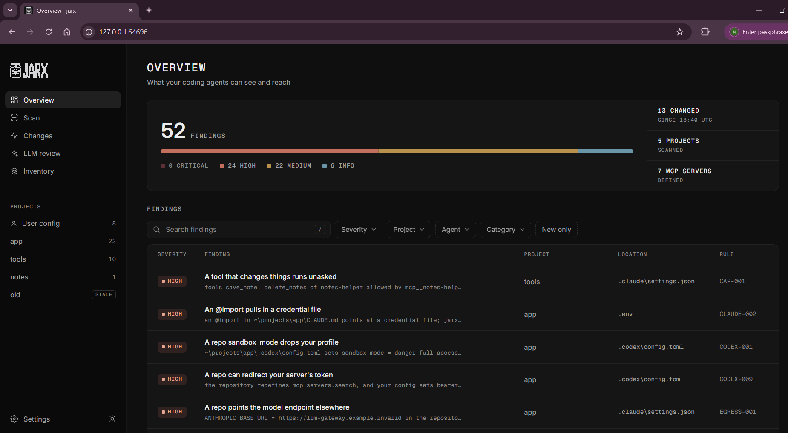

<p align="center">
  <picture>
    <source media="(prefers-color-scheme: dark)" srcset="docs/logo-light.svg">
    
  </picture>
</p>

<p align="center">
  Shows what Claude Code and Codex can see and reach on your machine, and flags what looks poisoned or leaky.
</p>

<p align="center">
  <a href="https://github.com/nickelsec/jarx/actions/workflows/ci.yml"></a>
  
  
</p>

<p align="center">
  
</p>

Coding agents load a lot of config you never look at as a whole: user and
project settings, `.mcp.json` files that came with a clone, plugins, skills,
hooks, instruction files and old session logs. jarx reads all of it and
answers questions like "can the agent read my AWS creds in this repo without
asking?" or "did this MCP server's tools change since last week?"

It's one Go binary with a CLI and a local dashboard. No account, no cloud,
nothing to install in the agents.

## Try it on the demo

The repo ships a fake home in `testdata/demo` with planted problems, so you
can see everything jarx does without it touching your real setup. You need
Go 1.27.4 or newer.

```
git clone https://github.com/nickelsec/jarx
cd jarx
go build ./cmd/jarx
./jarx scan --home testdata/demo
./jarx ui --home testdata/demo
```

On Windows the binary is `jarx.exe`, so run `.\jarx.exe scan --home testdata/demo`.

If you installed jarx with `go install`, the demo folder isn't part of that,
since `go install` only builds the binary. Clone the repo and point the
installed `jarx` at it: `jarx scan --home jarx/testdata/demo`.

`--home` makes jarx treat that folder as your home. It reads nothing outside
it, and it keeps its own state in `testdata/demo/.jarx-state`. The demo scan
makes no network calls; CI checks that on every push.

## Run it for real

```
go install github.com/nickelsec/jarx/cmd/jarx@v0.1.0
jarx scan
jarx ui
```

`jarx scan` finds every project the agents know about from their own records
and prints the findings, worst first. `jarx ui` prints a link to the
dashboard.

## Commands

| Command | What it does |
|---|---|
| `jarx scan` | Scan and print the findings. `--all` shows every finding and the full inventory, `--no-probe` doesn't start or contact any MCP server, `--no-history` skips session history, `--llm` adds the LLM review. Extra paths are scanned along with the projects jarx finds. |
| `jarx ui` | Start the dashboard on `127.0.0.1` and print a one-time link. Ctrl+C stops it. |
| `jarx setup` | Show jarx's own settings. `repo add` and `repo rm` keep extra project paths, and `llm` sets up the optional LLM review. |
| `jarx --version` | The version, and how fresh its advisory data is. |

`scan`, `ui` and `setup` all take `--home <dir>`.

## What it checks

- Which projects each agent knows about, and whether it trusts them.
- Instruction files and their imports, memory, skills, subagents and hooks.
- MCP servers in every scope: which ones the agent would start, their tools
  (by starting or asking the servers the agent would use anyway), and
  whether a tool's description changed since the last scan.
- Text aimed at the agent: hidden or invisible characters, instructions to
  ignore the user or keep quiet, pointers at credential files.
- Permissions, modes and sandbox settings, including allow rules that run
  more than they look like and deny rules that don't hold.
- Credentials: which ones each agent can actually read, per channel, from its
  settings and from the modes you ran it in.
- Secrets sitting in config, instruction files and session history.
- Where each agent talks to, and installed agent versions with known
  advisories.
- What changed since the last scan.

## Safety

- Read only. jarx never writes agent config. The only folder it writes is its
  own state dir.
- jarx never stores, shows or sends a credential's value. `.env` files are
  read for key names only. Any secret it finds is masked the moment it's
  found, and shows up as `REDACTED:<type>` with a fingerprint.
- jarx never calls an MCP tool or reads an MCP resource. It only asks a
  server for its lists.
- Network: there's no telemetry or update check. By default `jarx scan`
  starts the local MCP servers the agent would start anyway (they run like
  they do for the agent) and asks remote ones for their tool lists. With
  `--no-probe` and the LLM review off, jarx makes no network calls at all.
- The LLM review is off until you set it up. It asks before anything is sent,
  sends masked artifacts only (instruction files, skills, hooks, tool
  descriptions), and never sends session history. The key stays in an env var
  you name, and jarx only reads it when a review or a connection test runs.
- The dashboard listens on `127.0.0.1` only, behind a one-time token, a
  session cookie, a Host check and an Origin check.

The full list of network calls is in [the PRD](docs/prd.md#network-calls).

## The dashboard

`jarx ui` scans when it starts and serves the result: findings with filters
and search, each one opening to the line it's about, what it means and what
to do. There's a Scan page to scan again and add extra repos, Changes with
the scan history, the LLM review checklist, and an Inventory of agents,
projects and MCP servers.

## Limits

- Static analysis only. Verdicts come from settings and the docs, not from
  watching the agent.
- Claude Code CLI and Codex CLI only.
- Anything set per run or kept off the machine isn't visible: `--mcp-config`
  and `--settings` overrides, Agent SDK servers, claude.ai connectors, and
  server-managed settings.
- Session history and Codex's own databases aren't documented formats. jarx
  reads them as observed and shows "unknown" when they don't fit.
- No JSON or SARIF output and no exit codes by severity, so it isn't a CI
  gate yet. No release binaries yet either.
- jarx doesn't say whether an MCP server is "official". There's no documented
  list to check against.

The full list is in [the PRD](docs/prd.md#limits).

## Docs

- [docs/prd.md](docs/prd.md): what jarx does and promises.
- [docs/design.md](docs/design.md): how it's built.
- [docs/progress.md](docs/progress.md): what's done, phase by phase.
