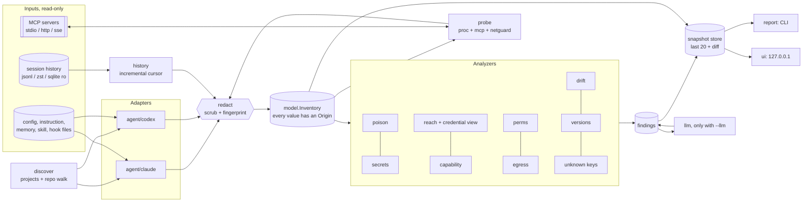

# jarx design

Status: draft v1. Last updated 2026-11-22. Goes with [prd.md](prd.md).

Go is decided. This doc covers everything else: how the code is split up, how
data moves through a scan, how the PRD's promises are enforced, and the phases
it gets built in. [progress.md](progress.md) tracks where we are.

## Decisions from research

These came out of research and change or sharpen the PRD.

### Codex sqlite: open the original read-only

The PRD said `mode=ro&immutable=1`. The SQLite URI docs say that if a file
opened as immutable "changes anyhow, then SQLite might return incorrect query
results and/or SQLITE_CORRUPT errors", and immutable mode also skips the
`-wal` file. Codex writes these files while it runs, so immutable is wrong.

Copying the database and its WAL to temp was also rejected. It would put
history with secrets on disk, even for a moment, which breaks promise 3.

What jarx does:

- Opens the original with `mode=ro`, then sets `PRAGMA query_only = 1` and a
  short `busy_timeout` (2s).
- If the database is locked, or the open fails because the `-shm` file can't
  be used, jarx skips that file and adds an info finding ("Codex was busy, try
  again"). Partial data is never guessed at.
- jarx never writes, checkpoints or vacuums.

Source: https://www.sqlite.org/uri.html

### Probes never use a proxy

The dial-time IP block only works when jarx connects directly. Through a
proxy, the dialer only sees the proxy's address, and the proxy resolves the
target. So probe traffic ignores `HTTPS_PROXY` and friends. Behind a
corporate proxy, remote servers show as `unreachable`, and the "where your
agent talks to" panel says "proxy set, probes went direct".

Source: https://www.agwa.name/blog/post/preventing_server_side_request_forgery_in_golang

### Windows process trees: suspended start plus a job object

Calling `AssignProcessToJobObject` after `cmd.Start` is racy. The child can
spawn grandchildren before it's in the job (golang/go#79927). That issue
asks for a job list in `SysProcAttr`. It's still an open proposal: the
change landed on Go's tip in November 2026 and was reverted on 2026-11-20,
and Go 1.27.4's `SysProcAttr` has no such field (checked 2026-11-23). jarx
does this instead:

1. Create a job with `JOB_OBJECT_LIMIT_KILL_ON_JOB_CLOSE`. The handle is not
   inheritable.
2. Start the server with `CREATE_SUSPENDED`.
3. Assign it to the job. If that fails, kill the still-suspended process,
   which never ran.
4. Resume its main thread: a Toolhelp32 thread snapshot finds it (a
   suspended process can't start more), then `ResumeThread`. Those calls are
   documented and in `x/sys/windows`, unlike ntdll's `NtResumeProcess`.
5. On timeout or when done, `TerminateJobObject` and close the job, which
   kills the whole tree.

On unix, the same thing is `Setpgid` plus `kill(-pgid, SIGKILL)`. A child
that leaves the group on purpose (`setsid`) gets away; that's in Limits.

The server's env is never jarx's own. It's a short baseline (PATH, home, temp
dirs, and what Windows needs to start a program) plus what the config
declares, and an empty env is passed as empty, never as nil, since nil would
hand over everything.

**`.bat` and `.cmd` files.** On Windows `npx` and many launchers are `.cmd`
files, and a `.cmd` always runs through `cmd.exe`. Go quotes arguments for
`CreateProcess`, not for `cmd.exe`, so an argument with `&`, `|`, `%` or a
quote could make `cmd` run something the config never named, which the
agent's own launcher might quote safely. `proc` refuses to pass an argument
with a `cmd.exe` metacharacter to a `.bat` or `.cmd` file, and the server
shows as "failed to start" with that reason.

This makes `golang.org/x/sys/windows` a direct dependency. It was already an
indirect one through go-keyring and modernc sqlite.

Sources: https://github.com/golang/go/issues/79927,
https://learn.microsoft.com/en-us/windows/win32/procthread/job-objects

### Hardened git for repo walks

A repo's own `.git/config` can run commands or change what gets listed. A
clone doesn't carry config, but a repo that arrived as an archive can, and
`include.path` can pull in more. On git 2.39, a plain `ls-files` in a hostile
repo really does run `core.fsmonitor` and really does follow `core.worktree`
to list another dir. So jarx runs exactly:

```
git --no-pager --work-tree=<repo> \
    -c core.fsmonitor=false -c core.useBuiltinFSMonitor=false \
    -c core.untrackedCache=false -c core.hooksPath=<devnull> \
    -c core.excludesFile=<devnull> -c safe.bareRepository=explicit \
    ls-files -z --cached --others --exclude-standard
```

Command line `-c` beats everything in the repo's config, including what
`include.path` pulls in. The env is built from scratch: PATH from
`platform.Env`, `GIT_OPTIONAL_LOCKS=0`, `GIT_CONFIG_NOSYSTEM=1`,
`GIT_CONFIG_GLOBAL=<devnull>`, `GIT_TERMINAL_PROMPT=0`,
`GIT_CEILING_DIRECTORIES=<repo's parent>` (so a dir that isn't a repo can't
use a parent repo's config) and `LC_ALL=C`, plus `SystemRoot` on Windows.
Nothing else from jarx's own env comes along. Stderr is thrown away. There's
a 10s timeout and a 64 MiB output cap, and every path git prints has to be a
plain relative path inside the repo or the whole output is dropped.

`ls-files` without `-m`, `-s` or `--eol` never reads file content, so
filter, diff and textconv drivers don't run. The pager, hooks and untracked
cache flags are defense in depth: git 2.39 doesn't run them here, but other
versions or paths might.

What's left: `include.path` still makes git read the files it names. That's
a read, not a run, and nothing it pulls in can override the `-c` flags.

jarx never touches `safe.directory`. If git refuses, isn't on PATH, or the
dir isn't a repo, jarx uses its own walk through fsys. Under `--home` it
never runs git at all, so the demo and the tests never start a binary from a
fake PATH. Tests prove each real defense with throwaway repos whose config
writes a marker file if it ever runs.

### MCP client speaks both protocol eras

Revision 2026-07-28 has no handshake at all. There's no `initialize`, no
session and no GET stream. Every request names its protocol version in
`_meta` (`io.modelcontextprotocol/protocolVersion`), and on HTTP also in a
`Mcp-Protocol-Version` header that has to match. The spec calls that
"modern" and everything up to 2025-11-25 "legacy". The client works with
both:

- **stdio:** send `server/discover` first, with 2026-07-28 in `_meta`. A
  `DiscoverResult` means a modern server. A `-32022`
  (`UnsupportedProtocolVersionError`) means modern but another version, so
  the client picks one from its `supported` list. Any other error, or no
  answer, means legacy, and the client falls back to `initialize`
  (2025-11-25 down to 2024-11-05).
- **streamable HTTP:** the same probe as a POST. A `400` without a modern
  error body means legacy, so `initialize` next. A `400`, `404` or `405`
  without a JSON-RPC body on that means the old HTTP+SSE transport.
- **lists:** follows `nextCursor` up to 50 pages. A list call answered with
  an `InputRequiredResult` (the server asking the client to run sampling or
  elicitation for it) gives no items, and the client never answers it.
- The client never answers anything the server sends it. The 2026-07-28
  stdio binding forbids server requests on stdout, but a hostile server
  sends them anyway, and `fakemcp` tests that. Requests, notifications,
  replies to ids it never sent and lines that aren't JSON are skipped and
  counted, so probe can say how noisy a server was.
- **HTTP headers:** modern requests carry `Mcp-Protocol-Version` and the
  required `Mcp-Method`. A legacy server gets the version header from
  2025-06-18 on, and its `Mcp-Session-Id` back. The configured headers
  (like a token) go on every request, the SSE GET included.
- **The old SSE endpoint** has to be on the same scheme and host as the
  configured URL. A server that names another origin could otherwise get
  the configured token sent to it, so the client refuses.
- **Limits:** one message is at most 10 MiB, and at most 32 MiB of list
  items is kept per server. Each list checks the server's capabilities
  first. A list method the server says doesn't exist is a note, not a
  failure.

`fakemcp` speaks both eras and both HTTP transports, so the client is tested
against each kind of server. A test also reads the `mcp` package's own
source and fails on any MCP method string but discovery and the lists, and
the request builder refuses every other method at run time.

Sources: https://modelcontextprotocol.io/specification/2026-07-28/basic/versioning,
https://modelcontextprotocol.io/specification/2026-07-28/basic/transports/stdio,
https://modelcontextprotocol.io/specification/2026-07-28/basic/transports/streamable-http,
https://modelcontextprotocol.io/specification/2024-11-05/basic/transports

### Claude managed settings and trust

From the settings, settings-reference, managed-settings and permissions
pages (read 2026-11-22):

- Settings files are strict JSON. A comment or trailing comma is an error,
  so there's no JSONC parser.
- Managed sources rank remote > MDM (macOS plist or `HKLM`) > files >
  `HKCU`. Under the default `managedSourcesBehavior: "first-wins"` only the
  top source with a policy key counts, apart from a short list of keys read
  from every admin source. `"merge"` combines them by kind of key. `HKCU`
  counts only when no admin source is present. jarx records every source it
  sees and marks the ones that lose as not in effect.
- The files are `managed-settings.json`, then `managed-settings.d/*.json` in
  alphabetical order (hidden and non-`.json` files skipped). Windows'
  legacy `C:\ProgramData\ClaudeCode\` isn't read by Claude, so not by jarx.
- Registry: the JSON in a `REG_SZ` or `REG_EXPAND_SZ` value named
  `Settings` under `SOFTWARE\Policies\ClaudeCode`, in `HKLM` and `HKCU`.
  `platform` reads it with `golang.org/x/sys/windows/registry` in a
  `_windows.go` file. Other OSes and `--home` get "not available".
- jarx doesn't read the macOS plist at all. Claude's docs give only the
  domain, and Apple's docs don't say where managed preferences live on disk,
  so the PRD lists it under Limits.
- Which file a key may come from is the Scope column of the settings index
  (Any file, User or managed, Managed, Global config and so on). That table
  ships as embedded data with an "as of" date and doubles as the known-keys
  list for the unknown settings report.
- Trust is the documented `projects["<path>"].hasTrustDialogAccepted` in
  `~/.claude.json`, keyed on the git repo root. Parent folder trust doesn't
  count, and home dir trust is never written. Anything but a bool is
  "unknown".
- `settings.local.json` lives at the repo root, except on Windows, outside a
  repo, or when ownership doesn't match. A file left in the start dir by
  older versions is read too. If it's tracked in git or `.claude` is a
  symlink, its allows wait for trust like project ones.

Sources: https://code.claude.com/docs/en/settings,
https://code.claude.com/docs/en/settings-reference,
https://code.claude.com/docs/en/managed-settings,
https://code.claude.com/docs/en/permissions

### What an @import can point at

A CLAUDE.md `@import` is a path someone else wrote, and Claude follows it up
to four hops, absolute or relative. So jarx treats every import target, and
every symlink on the way to one, as untrusted. Checks live in `fsys`, so no
reader can skip them:

- **Credential files.** `fsys` asks `credmeta.Location` about the path and
  about where its symlinks lead, and refuses content reads of either with
  `ErrCredential`. Stat still works, for existence checks. An instruction
  that pulls in a credential is listed as "credential file, not read" and
  raised as `JARX-CLAUDE-002`, because Claude would load the secret even
  though jarx won't.
- **Network paths.** UNC paths (`\\host\share`, `\\?\UNC\...`), the `\\.\`
  device namespace, and `/net` and `/Network` on unix are refused from the
  text alone. A symlink is resolved one component at a time and its target
  is checked as text before anything looks it up, so a link to a share
  can't make jarx contact it (on Windows, a lookup can send the share your
  NTLM hash). `\\wsl$` is allowed, as the docs say it isn't a network path.
- **Things that aren't files.** `ReadFile` and `Open` stat first and refuse
  anything that isn't a regular file, so a FIFO can't block a scan and a
  device can't be read forever.
- **Loops and fan-out.** Imports stop at Claude's four hops, a file is listed
  once per project however often it's imported, and one file can name at
  most 500 imports.
- **Escaping the fake home.** Absolute import paths go through `MapPath`,
  and `os.Root` keeps every read and link under `--home` inside it.
- **The terminal.** A file name or file text is printed by `report`, which
  escapes C0 and C1 controls, DEL and the Unicode bidi controls, so a hostile
  name can't recolor, move the cursor, fake a new line or flip the text.

Sources: https://code.claude.com/docs/en/memory#import-additional-files,
https://code.claude.com/docs/en/memory#share-rules-across-projects-with-symlinks

### Nothing a hook, skill or plugin declares runs

Hooks, skills and plugins all carry things Claude runs: hook commands,
`http` hooks that POST to a URL, `mcp_tool`, `prompt` and `agent` hooks,
the `` !`cmd` `` and ` ```! ` blocks a skill runs before Claude sees it,
plugin hook scripts, plugin dependency installs and marketplace fetches.
jarx reads all of it as text and never runs any of it:

- Process starts are lint-banned outside `discover` (hardened git), and the
  network is `netguard`'s alone, so the adapter has no way to run a command
  or send a request.
- Commands are shown as written. jarx resolves only `${CLAUDE_PROJECT_DIR}`
  and `${CLAUDE_PLUGIN_ROOT}`, and only to find a hook script so it can read
  it. Every other variable stays as written, so an env secret can't end up
  in the output.
- Hook scripts and plugin files are read through `fsys`, with every guard
  from "What an @import can point at".
- A canary test plants each hook type, a hook script, skill injection and a
  plugin hook, each of which would write a marker file or call a local test
  server if it ran. It scans and checks that neither happened.
- `installed_plugins.json` names its fields in the docs but not its shape,
  so jarx reads it as an observed format and calls a plugin's install state
  unknown when the file doesn't match.

Sources: https://code.claude.com/docs/en/hooks,
https://code.claude.com/docs/en/skills,
https://code.claude.com/docs/en/sub-agents,
https://code.claude.com/docs/en/plugins/loading,
https://code.claude.com/docs/en/plugins-reference

### Codex settings that quietly override others

From the Codex config, permissions and managed configuration docs (read
2026-11-22). jarx keeps every layer with its origin and marks the ones that
lose, so an override shows up as a "not in effect" row with the reason:

- **`sandbox_mode` wins over `default_permissions`.** If any loaded layer
  sets `sandbox_mode`, including a trusted project's `.codex/config.toml`,
  Codex uses the legacy sandbox and every rule in the permission profile
  stops applying. A managed `allowed_permission_profiles` is the only thing
  that reverses it. When a project layer does it to a profile set elsewhere,
  that's `JARX-CODEX-001` (high): a repository quietly turning off your deny
  rules is the same class of risk as `JARX-CLAUDE-002`. Your own layers
  doing it is `JARX-CODEX-005` (medium).
- **Permission profiles merge by name**, path by path, highest layer first,
  so a trusted project can replace one entry in your profile.
  `JARX-CODEX-002` flags a project that touches a profile another layer
  defines.
- **Legacy `managed_config.toml`** sits above `config.toml` and CLI flags at
  startup (`/etc/codex/` on Unix, the Codex home on Windows).
- **Profiles** apply only with `--profile`, which jarx can't see, so profile
  files are listed as not in effect with that reason.
- **Requirements** don't win quietly: a disallowed value falls back to an
  allowed one and Codex tells the user. jarx marks the value not in effect
  with the allowed list.

Sources: https://developers.openai.com/codex/config-file/config-basic,
https://developers.openai.com/codex/config-file/config-advanced,
https://developers.openai.com/codex/permissions,
https://developers.openai.com/codex/enterprise/managed-configuration

### Codex's instruction cap is described two ways

The AGENTS.md guide says Codex "stops adding files once the combined size
reaches" `project_doc_max_bytes` (32 KiB by default). The advanced config
page says it's "how much to read from each `AGENTS.md` file". jarx doesn't
pick one:

- A file is marked not in effect only when the per-file reading cuts it,
  since that reading cuts the least. Saying the agent doesn't see something
  it might see is the worse mistake.
- The byte limit Codex reads under the per-file reading goes on the
  instruction, and a note says what the combined reading would cut, counting
  raw bytes (a masked secret changes the text's length) in chain order:
  the global file, then the project root down.
- The rules always get the whole file. Text past the cap isn't in the first
  prompt, but it's on disk and the agent can read it with a tool.
- A repository can set the cap and the fallback filenames in its own
  `.codex/config.toml`, so `JARX-CODEX-006` flags a trusted project that
  does.

Source: https://developers.openai.com/codex/guides/agents-md,
https://developers.openai.com/codex/config-file/config-advanced

### Which HTML comments the agent reads

The memory docs say "block-level HTML comments in CLAUDE.md files are
stripped before the content is injected into Claude's context", that
"comments inside code blocks are preserved", and that the Read tool still
shows them. Nothing else is documented.

| Where | Agent reads it | jarx |
|---|---|---|
| Block-level comment in a CLAUDE.md file | no, stripped | skipped |
| Inline comment in a CLAUDE.md file | not documented | flagged |
| Any comment in rules, imports, `CLAUDE.local.md`, skills, output styles, AGENTS.md | not documented | flagged |
| Comment in a fenced code block or a code span | yes, but it renders as code | not hidden, skipped |

Where the docs are silent, jarx assumes the agent reads the comment.
Missing a hidden instruction is the worse mistake. A block-level comment is
one that starts its line with at most 3 spaces of indent (CommonMark). The
comment itself is info; what's in it goes through the content rules, and a
hit there is the high hidden-text rule.

Source: https://code.claude.com/docs/en/memory

### Allows that run more than they look like

An allow rule's command pattern goes through `catalog/commands.tsv`. Each
row is a program, an optional subcommand, a class (runs any code, runs the
repo's code, or has an escape) and the why, in our own words.

- Claude splits compound commands and strips wrappers like `timeout` and
  `nice` before matching, and its prefix rules can't approve `watch` or
  `find -exec`. So those aren't in the table. `npx`, `docker exec` and
  `xargs` with flags aren't stripped, so they are.
- A trailing `:*` reads like ` *`. The program loses its dir, `.exe` and
  version suffix, so `/usr/bin/python3.12` is `python`. A relative path is a
  file in the repo.
- A listed subcommand matches open or exact (`npm run *`, `npm test`). A
  program's own row matches only with open args right after it, or flags
  then open args (`python -c *`). Task runners like `make` match however
  they're called, since every target is the repo's. An interpreter with a
  script path (`python scripts/build.py *`) runs a repo file.
- `git` is its own class: `git -c` and aliases can run any command, but it's
  the most common allow there is, so it's medium, not high.

Claude path rules resolve the way the permissions docs say: `//path` from
the root, `~/path` from home, `/path` from the settings source (`~/.claude`
for user settings, the project otherwise), anything else from the working
dir. A path with no glob covers everything under it. Each grant is tested
against credmeta's sample credential paths.

### Unknown keys and typos

Each adapter checks the keys it reads against its own table and leaves a
`model.Unknown` with the key, the file, and, when there is one, the known key
it's probably a typo of (`Near`) or what the docs say about it (`Note`).
`analyze/unknown` only reads those, so the agents' tables stay in the
adapters.

- A typo is checked against keys at the same level: `permissions.defaultMod`
  against the other `permissions` keys, `[mcp_servers.x].comand` against the
  other server keys. A tie gives no guess.
- Codex's walk goes into a table only when the reference lists keys under
  it. That keeps it out of maps of names you choose, like
  `mcp_servers.<id>.env`, and out of `[hooks]`.
- Whether a typo is a safety typo depends on the key it was meant to be.

### Snapshots keep hashes, not text

A snapshot is jarx's own list of items, not a dump of the model. Each item
has an identity (its project, its kind and a key like `claude allow Bash(*)
in <file>`) and a state: in effect and why, a value, and a 16-hex SHA-256 of
its masked text. The diff matches items by identity, so it says "this allow
went away", not "line 12 changed".

- Snapshots go through `jarxdir` as `snapshots/<UTC time>-<random>.json`,
  and each save drops all but the newest 20.
- Reading one back puts every string through the scrubber again. That's
  safe because scrubbing is idempotent: a match that overlaps a mask the
  scrubber writes is left alone. A mask only counts when it's one of the
  scrubber's own kinds, maybe with a fingerprint, ending at a word boundary,
  so text dressed up as a mask, like `REDACTED:ghp_<token>`, can't hide the
  token behind it.

### Placeholders are info, not unmasked

A pattern match is always masked. Whether it looks like a placeholder only
changes the finding: `JARX-SECRET-003` (info) instead of 001 or 002. This
keeps the noise of example values out of the high findings without ever
showing a real secret.

- Token formats judge by entropy. Their bodies are long and random, so
  `ghp_aaaa...` is clearly fake.
- The name rule judges by shape: words like `example`, `changeme`, `your`
  or `xxx`, an `<angle bracket>` hole, or one char repeated. Entropy only
  counts from 16 chars up. Entropy per char can't go past log2 of the
  length, so under 8 chars every value scores below 3 bits, and a real
  short password would always look fake.

### Claude MCP config and which servers start

From the mcp, managed-mcp, settings-reference and sub-agents pages (read
2026-11-23).

Where servers come from:

- **User scope:** top-level `mcpServers` in `~/.claude.json`.
- **Local scope:** `projects["<path>"].mcpServers` in `~/.claude.json`. The
  same entry holds `disabledMcpServers` and `enabledMcpServers`, the
  per-project `/mcp` toggles. `disabledMcpServers` turns off user, plugin and
  managed servers. `enabledMcpServers` only turns on built-in servers that
  default to off, so jarx ignores it for configured servers, like Claude
  does.
- **Project scope:** `.mcp.json` at the project root.
- **Plugins:** `.mcp.json` at the plugin root, or `mcpServers` in
  `plugin.json`, started when the plugin is enabled.
- **Managed:** `managed-mcp.json` in the managed dir (same format as
  `.mcp.json`), and `managedMcpServers` in managed settings (remote servers
  only: `https://`, no `command`, no `headersHelper`, no `${VAR}`). Claude
  never reads `managedMcpServers` from HKCU or from user, project or local
  files.
- **Subagents:** `mcpServers` in agent frontmatter. A string is a reference
  to a configured server. An inline definition in a project
  `.claude/agents/` file loads only once the folder is trusted. One in
  `~/.claude/agents/` or a managed agent doesn't wait. Plugin agents ignore
  the field.

How `.mcp.json` servers get approved is documented, so it's not an observed
format. `enableAllProjectMcpServers` and `enabledMcpjsonServers`
count from user, managed and `--settings` files right away, from the project
file only once the folder is trusted, and from `settings.local.json` under
the same trust rule as local allows. The approval dialog writes to
`settings.local.json`. `disabledMcpjsonServers` in any file rejects the
server. A project server with no approval is "approval unknown, not probed",
since jarx can't tell whether a `-p` or SDK run would load it without
asking.

Managed policy, in the documented order:

1. A `managed-mcp.json` takes full control: only its servers and
   `managedMcpServers` load. User, project, local and plugin servers are
   not in effect, with that reason. A `strictPluginOnlyCustomization` that
   locks `mcp` stops `~/.claude.json` and `.mcp.json` servers but keeps
   plugin ones.
2. `deniedMcpServers` from every scope merges, and a match by name, command
   or URL blocks the server. Nothing overrides a deny.
3. `allowedMcpServers` merges from every scope, or only from managed when
   `allowManagedMcpServersOnly` is on. Unset allows everything, `[]` allows
   nothing. A remote server needs a `serverUrl` match (a `serverName` match
   only counts when there's no `serverUrl` entry), and stdio works the same
   with `serverCommand`. `managedMcpServers` and `managed-mcp.json` servers
   with no `${VAR}` outside `env` skip this check.

`serverCommand` matches the exact command and args. `serverUrl` takes `*`
wildcards, a case-insensitive host, and the default port unless the host has
a `*` or a port is given. Both sides expand `${VAR}` before matching. jarx
expands the server's side from the injected env and the policy side from the
startup env plus managed `env`, which under `--home` is just `.jarx-env`.

#### The same server name in more than one scope

The docs say Claude connects to one definition, the whole entry from the
highest source, with no merging of fields:

1. a `managed-mcp.json` entry, then `managedMcpServers` (by name)
2. local, then project, then user (by name)
3. plugin servers, then claude.ai connectors, matched to the servers above
   by endpoint, not by name. Two URLs are the same endpoint when they differ
   only in scheme or host case, the default port or a trailing slash. A
   `managedMcpServers` entry also wins over a plugin with the same URL.

jarx keeps every definition, each with its own origin, and marks the ones
that lose as not in effect: "overridden by the local server with the same
name". Two choices on top of that:

- **When the winner itself won't start.** The docs don't say whether a
  definition that's denied, rejected or waiting on approval still hides a
  lower one with the same name. jarx doesn't guess either way: the lower
  definition is "may start" with a note saying why, and probe treats it as
  one that starts, since it would start on its own if the higher one
  weren't there. Saying a server can't load when it might is the worse
  mistake.
- **Names carry rules.** Permission rules (`mcp__github__*`), `serverName`
  entries and hook matchers are keyed by name. So a repository's `.mcp.json`
  that reuses the name of one of your user servers, once approved, replaces
  it, and your allows for that name now apply to the repository's server.
  The MCP config rules item flags that, and also two scopes defining one
  name with different endpoints, which Claude only warns about.

A name Claude reserves for its built-in servers (`workspace`,
`claude-in-chrome`, `computer-use`, `Claude Preview`, `Claude Browser`) is
skipped at load, so jarx marks it not in effect.

Sources: https://code.claude.com/docs/en/mcp,
https://code.claude.com/docs/en/managed-mcp,
https://code.claude.com/docs/en/settings-reference,
https://code.claude.com/docs/en/sub-agents

### Codex MCP config and which servers start

From the Codex mcp, config-reference and managed-configuration pages (read
2026-11-23).

- **Where servers come from.** `[mcp_servers.<id>]` tables in any config
  layer: legacy `managed_config.toml`, project `.codex/config.toml` files,
  profile files, the user's `config.toml` and `/etc/codex/config.toml`. A
  server in a layer Codex doesn't load (an untrusted project, a profile file
  without `--profile`) doesn't start, with the layer's reason.
- **Shape.** A table with `command` is stdio and one with `url` is
  streamable HTTP. Neither means it doesn't start. Both isn't documented, so
  it may start, with a note. `enabled = false` turns it off.
- **Fields jarx keeps.** `args`, `env`, `env_vars` (names, with a remote
  source shown), `cwd`, `bearer_token_env_var`, `http_headers`,
  `env_http_headers` (header to var name), `http_headers_helper`, `auth`,
  `enabled_tools`, `disabled_tools`, `default_tools_approval_mode` and each
  tool's `approval_mode`. Env and header values are masked by their name, the
  same way as for Claude.
- **requirements.toml.** Its `mcp_servers` table is an allowlist: the id and
  its identity must both match, and an empty table turns every server off.
  `identity.command` as a string matches the command alone. As a table it
  needs the exact executable and one matcher per argument, in order.
  `identity.url` is an exact string or a matcher table. Matchers are
  `exact`, `prefix` and a `regex` that has to match the whole value. A regex
  jarx can't compile makes the server "may start".

#### The same id in more than one layer

The docs don't say whether a higher layer's `[mcp_servers.<id>]` replaces a
lower one's whole or merges with it field by field. Either way the highest
loaded layer's fields are the ones in use, so that definition is the one
that starts, and the lower ones are "overridden" with that reason. When a
lower layer sets a field the one in use doesn't, the one in use gets a note
naming it. That's the case that matters: a trusted repo that redefines your
server with its own `url` could get your `bearer_token_env_var` merged in,
so your token goes to its host. The MCP config rules item turns that into a
finding.

Plugin servers wait for Codex plugins, which jarx doesn't read yet.

Sources: https://developers.openai.com/codex/mcp,
https://developers.openai.com/codex/config-reference,
https://developers.openai.com/codex/enterprise/managed-configuration

### How probe starts and reaches servers

- **Raw launch data, kept out of every output.** Probe has to start a server
  with the real env values and send the real configured tokens, as the agent
  would. The adapters put those on `model.Server` as a `model.Launch`, a
  leaf type built like `Path`: its contents are unexported, only probe reads
  them (through `Spec`, which lint bans everywhere else), and it prints as `[launch]` for every fmt verb and
  encodes as JSON `null`. Snapshots, the report and the analyzers never see
  it, and a test proves it never prints or encodes a value.
- **Once per definition.** A server that applies in several projects, like a
  user server, is probed once and the result goes on every copy. A stdio
  server runs in its project's dir, so for those the project is part of the
  identity.
- **Claude's credential variables.** The docs list examples of variables that
  read as empty in a remote server's URL and headers, and the families they
  come from, not a full list. jarx reads those examples and the families
  (`ANTHROPIC_*`, `CLAUDE_CODE_*`, the cloud providers' prefixes, `*_PROXY`)
  as empty, except `*_BASE_URL`, so it never sends a credential Claude would
  hold back. The cost is a possible 401 where Claude would get in.
- **Codex `auth`.** The docs make `oauth` the default, and without stored
  credentials Codex connects with none. So only an explicit `oauth` or
  `chatgpt` makes a server "requires auth".
- **Reasons don't quote errors.** A status reason never includes an error's
  text, since a URL in it can hold a token. It names the kind of failure.

#### Under --home

Probe never contacts a remote server and never starts a program from the
fake PATH. Both show as "not started" with that reason. The one thing it
starts is the demo home's fake server: a stdio server whose command is
`jarx-fakemcp <script>`. Probe reads the script through `fsys`, so it has to
be inside the fake home, and runs the jarx binary itself in a hidden
`__fakemcp` mode with the script as its argument and a marker variable in
its env. The hidden mode refuses without the marker. On the real machine
`jarx-fakemcp` is an ordinary command name, looked up on PATH like any
other, and a test proves probe never starts jarx for it there. A remote
server can't use it at all.

So a demo scan probes over stdio pipes only, and the offline CI job keeps
probing on, which proves the probe makes no network syscall.

### Where credentials live and what jarx reads

Each CLI's own docs give its paths, and most let an env var move them.
`credmeta.Location`, the read guard and the metadata parsers all use one
table, so a moved credential is still refused by `fsys` and still found.
The phase 3 table had two Windows paths wrong (gh and gcloud) and no env
vars; this replaces it.

| Kind | Where (first match wins unless it says merged) | Source |
|---|---|---|
| aws | `AWS_CONFIG_FILE`, else `~/.aws/config`; `AWS_SHARED_CREDENTIALS_FILE`, else `~/.aws/credentials`; `~/.aws/sso/cache` and `~/.aws/cli/cache` | AWS SDKs and tools reference, AWS CLI user guide |
| gh | `GH_CONFIG_DIR`, else `$XDG_CONFIG_HOME/gh`, else `%AppData%\GitHub CLI` on Windows, else `~/.config/gh`; the file is `hosts.yml` | `gh help environment` |
| gcloud | `CLOUDSDK_CONFIG`, else `%APPDATA%\gcloud` on Windows, else `~/.config/gcloud` | gcloud "Managing configurations" |
| azure | `AZURE_CONFIG_DIR`, else `~/.azure` | Azure CLI configuration |
| docker | `DOCKER_CONFIG`, else `~/.docker`; the file is `config.json` | docker CLI reference |
| kube | `KUBECONFIG` as a list (`:` on unix, `;` on Windows), merged; else `~/.kube/config` | kubernetes.io kubeconfig |
| ssh | `~/.ssh` (`%USERPROFILE%\.ssh` on Windows) | OpenSSH, Microsoft's OpenSSH for Windows |
| git | `~/.git-credentials`, then `$XDG_CONFIG_HOME/git/credentials` (else `~/.config/git/credentials`), both read | git-credential-store |
| netrc | `NETRC` (curl 8.16 and later), else `~/.netrc`; on Windows `.netrc`, then `_netrc` | curl man page |
| npm | `NPM_CONFIG_USERCONFIG`, else `~/.npmrc`; a project's own `.npmrc` too | npm config docs |
| pypi | `~/.pypirc` | PyPA `.pypirc` spec |
| gnupg | `GNUPGHOME`, else `~/.gnupg` | GnuPG manual |
| login files | `CLAUDE_CONFIG_DIR` or `~/.claude`, `.credentials.json`; `CODEX_HOME` or `~/.codex`, `auth.json` | agents' docs |
| env files and keys | `.env`, `.env.*`, private key names and extensions in a project | jarx's own list |

Two things the docs leave out, so jarx leaves them out too: GnuPG's
Windows default (only forum posts name `%APPDATA%\gnupg`), and ssh keys
that `~/.ssh/config` points at from other places (a later item, since it
means reading the ssh config's `IdentityFile` lines).

What jarx keeps from each, and nothing else. A parser streams the file
through `fsys` (capped like any read), keeps only these fields and drops the
rest as it goes:

| Kind | Kept |
|---|---|
| aws | profile names, and which kind of credential each has from its key names (static keys, sso, `credential_process`, a role) |
| gh | host names and each host's `user`, and whether a token sits in the file or the keyring |
| docker | registry hosts in `auths`, whether an entry holds an inline `auth`, and `credsStore` and `credHelpers` helper names |
| kube | context, cluster and user names, `current-context`, and which kind of credential each user has from its key names (token, client key, exec, auth provider) |
| ssh | each private key's type and whether it has a passphrase: an OpenSSH key's cipher name from the first bytes of its body (`none` means no passphrase, per `PROTOCOL.key`), a PEM key's `Proc-Type` header, PKCS#8's `ENCRYPTED PRIVATE KEY` label, PuTTY's `Encryption` line |
| git | scheme and host of each stored URL, never the user or password |
| netrc | machine names and `default`, never `login`, `password` or `account` |
| npm | registry hosts that have an auth key, and the key's name (`_authToken`, `_auth`, `_password`) |
| pypi | index server names and their repository hosts |
| gcloud | configuration names, the active one, and which credential files exist |
| azure, gnupg, login files | existence only |
| env files | key names |

gh's `hosts.yml` and kubeconfig are YAML, and jarx has no YAML parser. A
small line reader that only knows those two shapes keeps the keys it needs
and drops every value it doesn't, so a value it misreads is dropped, not
kept. A test feeds a canary secret through every parser and checks it never
shows up in what the parser returns, the scan output or the snapshot.

### Dashboard token goes into a cookie

`jarx ui` prints `http://127.0.0.1:<port>/?t=<token>`. The first request
trades the token for an `HttpOnly; SameSite=Strict` cookie and redirects with
303, so the token leaves the address bar and the browser history. Writes are
checked by Go 1.25's `http.CrossOriginProtection` (it uses `Sec-Fetch-Site`
and `Origin`). Every request also goes through a Host allowlist
(`127.0.0.1:<port>`, `localhost:<port>`) to stop DNS rebinding. A strict CSP
blocks inline script, and `frame-ancestors 'none'` stops framing.

Sources: https://www.calhoun.io/csrf-protection-via-headers-in-go-125,
https://developer.mozilla.org/en-US/docs/Web/Security/Attacks/CSRF

## Guarantees enforced by structure

The PRD's promises shouldn't depend on everyone remembering them. Each one has
a spot in the code that makes breaking it hard.

| Promise | How the code makes breaking it hard |
|---|---|
| Secrets never leak | Model text fields are `redact.Text`. Only the `redact` package can build one (unexported field). `report`, `ui`, `snapshot` and `llm` only take `redact.Text`, so there's no way to put a raw string on screen, on disk or on the wire. Anything that matches a secret pattern is always masked. Entropy only flags a match as a likely placeholder, it never decides whether to mask, because showing a real secret is far worse than hiding a fake one. A reflection test walks every type reachable from `model.Inventory` and fails on a raw string anywhere: fields (exported or not), named string types, pointers, slices, arrays, map keys and values, `[]byte`, `[]rune`, interfaces, funcs, chans, embedded and generic types, and structs from other packages that aren't allowlisted. The test has one fixture per hiding spot, so a gap in the walker fails too. `model.Path` keeps the raw path only for fsys reads, and prints and encodes as the masked path for every fmt verb and in JSON. The one exception is `model.Launch`, the raw launch data probe needs to start a server the way the agent would: like `Path` it keeps its contents unexported, it prints as `[launch]` and encodes as `null` (with a test for every fmt verb and JSON), and `forbidigo` bans `Launch.Spec` everywhere but `internal/probe` and tests. |
| Nothing raw reaches the terminal or a log | Only `report` writes output. `forbidigo` bans `fmt.Print*`, `fmt.Fprint*`, `os.Stdout`, `os.Stderr`, `print`, `println`, `log` and `log/slog` everywhere else (`cmd/jarx` may use `os.Stdout` and `os.Stderr` only to hand them to `report`). `report` takes values only as `redact.Text`, and its format string has an unexported type, so a string variable won't compile as the format. `report.Error` scrubs error text, since a parser error can quote the line it failed on. The limit: a package handed an `io.Writer` could still call `Write` on it, but only `cmd/jarx` can reach the real stdout and stderr, so that needs a new parameter that review would catch. |
| Never calls a tool | The `mcp` package has constants only for `server/discover`, `initialize`, `notifications/initialized`, `tools/list`, `prompts/list` and `resources/list`. A `go/ast` test fails if any other method string shows up in the package. |
| Only the listed network calls | `netguard` is the only package allowed to make a network connection. golangci `forbidigo` bans `http.Get`, `http.Client`, `http.Transport`, `http.DefaultClient`, `net.Dial*`, `net.Dialer`, `tls.Dial*`, `tls.Client`, DNS lookups (`net.Lookup*`, `net.Resolver`), `net/smtp` and `net/rpc` everywhere else. Inside netguard, every connection is checked in the dialer's `Control` hook, after DNS and right before connect, on the exact IP being connected, so DNS rebinding and reconnects can't get past it. A literal IP host is also checked before dialing, because Go rewrites `0.0.0.0`, `::` and an empty host into a dial to the local machine before `Control` sees it. The tests run with a fake DNS server and a test-only rule that refuses any non-loopback connection, so a broken guard fails its tests instead of reaching a real address. |
| Only discover runs a process | `forbidigo` bans `exec.Command`, `exec.CommandContext`, `exec.LookPath` (it reads the real PATH), `os.StartProcess` and `syscall.Exec`/`ForkExec` outside `discover`, which only runs hardened git. `proc` joins it in phase 4. git is found through `platform.Env`'s PATH, never under `--home`. |
| Never reads a credential value | `fsys` refuses content reads of any path `credmeta.Location` calls a credential, checked on the path and on where its symlinks lead, so following an `@import` or a symlinked rule can't open one. Stat still works for existence checks. The phase 5 metadata parsers get their input through an explicit `fsys` method, not by opening files themselves. |
| Never writes agent config | `fsys` has no write methods. The only writer is `jarxdir`, which is rooted at jarx's state dir (`os.UserConfigDir()/jarx`, or `<home>/.jarx-state` with `--home`) with `os.Root`. `forbidigo` bans `os.WriteFile`, `os.Create`, `os.Mkdir*`, `os.Remove*`, `os.Rename` and friends everywhere else (tests may write fixtures). |
| Tests and demos never touch the real machine | Adapters take an injected `platform.Env` (home, GOOS, env, PATH, state dir, system roots). `forbidigo` bans `os.UserHomeDir`, `os.Getenv` and friends outside `platform`, and bans `os.Open`, `os.ReadFile`, `os.Stat`, `os.OpenRoot`, `filepath.Walk*` and friends outside `fsys`, `jarxdir` and `platform`. Under `--home`, `fsys` confines every read to the fake home with `os.Root`, so a fixture that points at a real path, a `..` trick or a symlink can't reach the real machine. `--home` builds a `platform.Env` with no system roots, registry, plists, real env or real PATH. |
| Only approved dependencies | golangci `depguard` lists the five approved modules plus stdlib. A new import fails lint until someone approves it. |

## Architecture



Three layers, matching the PRD:

1. **Adapters** know one agent each: its paths, formats, precedence, trust
   rules and quirks. Nothing outside an adapter knows an agent's file layout.
2. **The model** is agent-neutral, and every value in it carries an `Origin`
   (file, scope, line where possible, and whether it's in effect, with a
   reason if not).
3. **Analyzers** only read the model. Adding an agent means writing an
   adapter. The analyzers stay the same.

The shape follows osv-scalibr (extractors feed an inventory, detectors read
it) and boughs' `internal/agent/<name>` split. jarx adds the `redact` and
`netguard` choke points that neither of those has.

## Data flow for one `jarx scan`

1. **platform** works out the OS paths. **discover** merges the agents'
   project records with the repos in `jarxdir`, then walks each repo with
   hardened `git ls-files` or the fallback walk.
2. Each **adapter** reads its files through `fsys`, parses them (JSON, JSONC,
   TOML, frontmatter), applies its own precedence and trust rules, and sends
   every string through **redact** before it reaches the model. Keys it
   doesn't recognize go to `model.Unknown`.
3. **probe** asks the model which servers the agent would start. Up to 4 run
   at once. **proc** spawns stdio servers in a job or process group.
   **netguard** handles remote servers. **mcp** sends `server/discover` (or
   `initialize` to a legacy server) and the list calls. Results go through redact and land on `model.Server` with a
   status.
4. **history** loads its cursor and reads only new bytes. It records
   permission modes, cwds and secret fingerprints. Codex sqlite is opened
   read-only in place.
5. Each **analyzer** reads the model and emits findings:
   `finding.Finding{ID, Severity, Origin, Evidence redact.Text}`.
6. With `--llm`, **llm** shows the preview, sends redacted artifacts,
   validates the JSON (one retry) and checks the quotes. Results are cached by
   hash.
7. **snapshot** writes the masked JSON, prunes to 20 and diffs against the
   previous one. **drift**, one of the analyzers in step 5, already read
   that previous snapshot to flag tools that changed. **poison** runs on
   every tool's current text, so a changed one is checked again.
8. **report** prints the result. **ui** serves the same snapshot.

## Terminal output

This is jarx's output style. Every command in every phase follows it. New
output goes into the blocks and the tree format below. It doesn't get a
new layout of its own. When something really fits no block, ask before
adding one, and add it here.

### A run, top to bottom

Every run starts with the pixel `JARX` banner, with the version next to
its last row, then the tagline. Then `jarx scan` shows what it checked,
then what it found, in this order:

1. a header: fake home or this machine, and the OS
2. **agents on this machine**: one row per agent, with its config dir and
   its project counts by trust, or "not found"
3. **scanned**: counts of what was read, with notes on what wasn't
4. one summary line: findings by severity, then what changed since the
   last scan
5. **changed since the last scan**, only when something did
6. **your user config**: user-level problems, once, since they apply to
   every project
7. one group per project, worst project first: its findings, then what
   the agents load there
8. a pointer to `jarx scan --all`

Where later phases go:

- Facts about an agent (MCP servers, the installed version) go on its row
  in the agents block.
- New things jarx reads (MCP servers and tools, credential locations,
  history sessions) become rows of counts in the scanned block, with
  skips as notes.
- Findings from new analyzers join the same groups: the project a file is
  in, or the user config group. They never get a block of their own.
- Per-project facts that aren't findings (an MCP server's tools, a
  credential's reach) are a line in the project's group, like "loads
  here", and in full under `--all`.
- Full lists and views go in the `--all` inventory, after the findings.

### Blocks

- A block is a bold heading in plain lowercase words, then a tree. Blocks
  are one blank line apart.
- There are no other heading styles: no underlines, boxes, rules, caps
  or emoji.
- A group heading may add facts after the name, joined by the list
  separator, like `~/projects/app  claude trusted · codex trusted`.

### Trees

- The glyphs are `├─ │ └─` on a terminal that shows UTF-8, and `+- | \-`
  otherwise. Nothing else draws structure.
- An entry is one line, or a title line plus detail lines. The first
  detail line hangs off the title on its own branch (`└─`), and later ones
  are indented under it.
- When the entries in a tree have more than one line, a line with just the
  tree bar sits between them. Trees of one-line entries stay tight.
- A long tree stops at a cap and ends in a count of the rest, like
  `… 6 more: 2 MED · 4 INFO  (jarx scan --all)`. Anything a user has to
  act on (critical and high findings) is never hidden by a cap.

### Findings

```
├─ HIGH  An @import pulls in a credential file  CLAUDE-002
│  └─ .env  an @import in CLAUDE.md points at a credential file; jarx…
│
└─ MED   A skill runs shell before Claude sees it  CLAUDE-003
   └─ .claude/skills/release/SKILL.md  release runs 1 shell command…
```

- The title line is the severity (`CRIT`, `HIGH`, `MED `, `INFO`, four
  wide so titles line up), two spaces, the rule's title with a capital
  first letter, two spaces, then the rule ID without `JARX-`. When the
  line has no room for the ID, it moves down next to the file.
- The detail line is the file, with `:line` when known, then the
  evidence. Under 80 columns the evidence gets its own line.
- A rule's `Title` is at most 42 chars, so the title line fits 80 columns.
  `NewRegistry` refuses a longer one. The longer reason goes in `Detail`,
  which `--all` shows as `why:`, with the rule's `Fix` as `fix:`.
- Findings are sorted worst first. A group shows at most 10, but every
  critical and high one always shows.

### Text

- Paths are relative to the project, or start from `~`. Evidence gets the
  same treatment, so absolute paths don't fill the line.
- Inline lists are joined with ` · `, or ` - ` in ASCII.
- Counts read as words with the right plural: `1 project`, `2 projects`.
- A note next to a count (what was skipped, why it wasn't read) is dim
  and sits in a column. When one note doesn't fit, every note in that
  tree moves to its own line, so they stay lined up.
- Words are plain and lowercase, with no em dashes.
- Text from a file is always escaped before it's printed, and only jarx
  picks colors, so a file can't color or move the terminal.

### Width, color and charset

- Lines never wrap. Each one is cut to the terminal's width with an
  ellipsis. `--all` wraps long evidence and reasons at spaces instead of
  cutting them.
- Colors are the basic 16 only, and the words always say the same thing,
  so nothing depends on color. Headings are bold. Notes, file names and
  rule IDs are dim. `CRIT` is bright red, `HIGH` red, `MED` yellow and
  `INFO` cyan. Trust is green for trusted, yellow for untrusted, and dim
  for unknown.
- `platform.DetectTerm` decides the rest. Color needs a terminal that
  takes ANSI escapes (on Windows, jarx turns on virtual terminal
  processing through `x/sys`), no `NO_COLOR`, and `TERM` other than
  `dumb`. Box drawing needs a terminal showing UTF-8 (the console's output
  code page on Windows, the locale elsewhere). Piped output is always
  ASCII with no color, because Windows PowerShell 5.1 re-encodes what a
  program prints. The width is the terminal's, then `COLUMNS`, then 80.
- Output has to look right in PowerShell, Windows PowerShell 5.1, cmd,
  Windows Terminal, macOS Terminal, iTerm2 and Linux terminals.

### The banner

- The banner is the same on every run, so two scans still diff cleanly.
- A version too long to sit next to it, like a dev build's, gets its own
  line instead of being cut.

### `--all`

`--all` is the same report with nothing held back: no caps, the evidence
wrapped instead of cut, each finding's `why:` and `fix:`, what platform
resolved about the machine before the report, and the full inventory
after it.

### Building on it

New output uses `report`'s pieces instead of printing around them:
`Style`, `line` and `seg` for text and tone, `emit` to cut a line to the
width, `tree` and `spacedTree` for blocks, and `branch` for title and
detail lines. Tests pin the layout with an exact expected view of the
demo scan at 80 columns, so a layout change shows up as a test change.

## Package layout

| Package | Job | PRD section |
|---|---|---|
| `cmd/jarx` | main, wiring only | CLI |
| `internal/cli` | subcommands with stdlib `flag` | CLI |
| `internal/platform` | OS facts only: home, GOOS, injected env, PATH, jarx's state dir, system roots (`/etc`, `/Library/Application Support`, `%ProgramData%`, `%ProgramFiles%`), and terminal facts for the report (a terminal or not, width, ANSI, UTF-8). Registry reads land here in phase 3 (macOS plists aren't read, see Limits in the PRD). Agent paths belong to the adapters, which join them onto these roots. | Scope, cross-platform rule |
| `internal/fsys` | the only file reader, with no write methods. Confined to the fake home under `--home`. A 10 MiB `ReadFile` cap, where every refused file is recorded so it becomes a "skipped, too large" finding and is never dropped silently. A skip list for bulk dirs (`node_modules`, `.git`, `vendor`, build output) that still keeps agent files inside them (`.claude/`, `.codex/`, `.agents/`, `CLAUDE.md`, `AGENTS.md`, `.mcp.json` and the like). Symlinks are listed but never descended into. Refuses network paths (and symlinks to them), anything that isn't a regular file, and content reads of credential locations (see "What an @import can point at"). | Walking a repo |
| `internal/jarxdir` | the only file writer: `os.Root` on jarx's state dir, atomic writes, for config, cursor, cache and fingerprint key. Also `config.json` (versioned, with the saved repos), which it reads without creating the state dir | What jarx writes to disk |
| `internal/redact` | `Text` type, scrubber that always masks pattern matches (with a likely placeholder flag for low entropy), `Secret` for values known to be secret, masks like `REDACTED:<type>:<12 hex fingerprint>`, HMAC fingerprint with a per-install key created lazily in the state dir. A `Text` keeps the kind and fingerprint of what it masked, never the value. | Promise 4, Secrets |
| `internal/model` | agent-neutral inventory, `Origin`, `Path`, `Setting[T]` (one layer per scope, highest first, with each layer marked in effect or not and why; adapters decide, the model only holds the result), `Project`, `Unknown`. Grows per phase. | Architecture |
| `internal/finding` | Finding, severity, rules as plain values with IDs like `JARX-MCP-001`, a `Registry` built by `scan` from every analyzer's rules (no global registry), worst-first sort, and `JARX-SCAN-001` for files fsys skipped as too large | Detection rules |
| `internal/discover` | merges every adapter's project records with extra paths, sets each project's status (ok, stale, outside fake home, not absolute, can't check), reports fsys skips as findings, and walks each repo with hardened git or the fallback walk | Project discovery |
| `internal/agent` | the adapter interface (`Agent`, `Projects`), the optional `SettingsReader`, `InstructionReader` and `ExtensionReader` that discover calls, and the shared `Context` (env, fsys, scrubber). Shared parsers (frontmatter keys and raw blocks, tool lists, `@` imports) land here in phase 3. Claude settings are strict JSON, so there is no jsonc parser. | Architecture |
| `internal/agent/claude` | Claude paths, precedence, trust, MCP approval, modes | Scope: Claude Code |
| `internal/agent/codex` | Codex paths, profiles, legacy `sandbox_mode` switch, requirements | Scope: Codex CLI |
| `internal/catalog` | embedded data: builtin tools, vendors, advisories, secret patterns, the command table, each with an "as of" stamp | Built-in tools catalog, Vendor badge, Advisory data |
| `internal/credmeta` | cred locations and safe metadata parsers (aws config, ssh header, gh hosts, `.env` keys). `Location` lands in phase 3 because `fsys` needs it to refuse credential reads; the parsers come in phase 5. It never imports `fsys`. | Credentials |
| `internal/analyze/secrets` | findings from what the scrubber masked: seen, plain text or placeholder | Secrets |
| `internal/analyze/poison` | text rules over every text the agent reads | Detection rules |
| `internal/analyze/perms` | effective permissions with origin and in-effect reason | Effective permissions view |
| `internal/analyze/mcpconfig` | rules on one MCP server definition: how it's installed and started and what its config hands it. Its own folder because none of the other analyzers is about server configs, and it isn't named `mcp` so it can't be mixed up with the client | MCP supply chain and config |
| `internal/analyze/reach` | per-channel verdicts, observed modes, credential view | Reachability verdicts, Credential view |
| `internal/netguard` | the one HTTP client. Blocks link-local, cloud metadata (including AWS over IPv6 and Alibaba's `100.100.100.200`), unspecified addresses and every IPv6 form that wraps a blocked IPv4 (mapped, compatible, NAT64, 6to4; Teredo and local-use NAT64 outright). Separate dial paths by scheme: https goes through the block then TLS, plain http also has to reach loopback. No proxy, no redirects, a 10 MiB body cap, 64 KiB headers, a 20s ceiling, no compression. | Network calls |
| `internal/proc` | `proc_windows.go` job objects, `proc_unix.go` process groups, baseline env | How a stdio server is started |
| `internal/mcp` | list-only client: stdio, streamable HTTP, legacy SSE, paging | The MCP client |
| `internal/probe` | which servers, env expansion rules, concurrency, status | MCP probing, Server status |
| `internal/analyze/capability` | three-layer view per tool | Capability view |
| `internal/analyze/egress` | the "where your agent talks to" panel | Where your agent talks to |
| `internal/snapshot` | versioned schema, retention, diff | Snapshots and diff |
| `internal/analyze/drift` | hash diffs, rerun poison on changed tools | Snapshots, Drift |
| `internal/history` | cursor, jsonl, zstd and read-only sqlite readers (observed formats) | Session history |
| `internal/analyze/versions` | installs, PATH winner, advisory match, catalog age warning | Agent installs and versions |
| `internal/analyze/unknown` | the unknown settings report | Unknown settings report |
| `internal/report` | the only output writer: `Out` and `Err` streams that take a literal format and `redact.Text` values, and an `Error` that scrubs error text. Also the scan report (see "Terminal output"), laid out for the terminal's width, colors and charset, and the banner. | CLI |
| `internal/ui` | server, middleware (host, token, CSRF, CSP), templates, embedded static files | Dashboard |
| `internal/keystore` | go-keyring for jarx's own entry, or an env var name | Optional LLM review |
| `internal/llm` | OpenAI-compatible client over netguard, preview, schema check and retry, quote check, cache | Optional LLM review |
| `internal/fakemcp` | a tiny MCP server (stdio and HTTP) with scripted tools, used by probe tests and the demo home | MCP probing, Demo home |
| `tools/vendorseed` | dev-only registry seeding where the namespace matches the vendor domain. Never linked into jarx. | Vendor badge |
| `testdata/<agent>/<version>/` | fake home trees per agent version | Fixtures per agent version |
| `testdata/demo/` | the demo home with planted problems | Demo home |
| `internal/analyze/<name>/testdata/<RULE-ID>/{poisoned,clean}/` | each rule's own fixtures | Testing and done criteria |

### Fixtures

- **Per rule:** every rule ID gets a `poisoned/` and a `clean/` dir, written
  first as the failing test (TDD). A table test walks all rule dirs, so a
  rule without both fixtures fails the build.
- **Per agent version:** fake home trees under `testdata/<agent>/<version>/`.
  When a format changes, a new version dir is added and the old ones keep
  passing.
- **History shapes:** Claude transcripts and Codex rollouts follow our
  format notes in the boughs repo (`docs/format-claude-code.md`,
  `docs/format-codex.md`), including replay: Claude replays inside one
  transcript, and Codex replays earlier items into a new rollout under
  `sessions/YYYY/MM/DD/`. Fields those notes don't cover (mode fields, `.zst`,
  sqlite) are built from observed structure, with a note in the fixture.
- **Demo home:** `testdata/demo/` is a full fake home with planted problems.
  Its risky MCP server is `internal/fakemcp`, so probing it runs our code,
  not a real package. A test runs `jarx scan --home testdata/demo` and checks
  for the expected findings, so the demo can't silently stop showing them.
- **Line endings:** `.gitattributes` sets `* text=auto eol=lf`, and marks
  `*.sqlite`, `*.zst` and images as `binary`, so fixture bytes (and hashes)
  are identical on Windows and Linux runners. Analyzer rule fixtures under
  `internal/analyze/*/testdata/` are `-text`, since some test exact bytes
  like CRLF or a BOM.

## Dependencies

Stdlib plus these, and depguard enforces the list:

- `github.com/BurntSushi/toml`
- `github.com/zalando/go-keyring`
- `github.com/klauspost/compress` (zstd)
- `modernc.org/sqlite`
- `golang.org/x/sys` (Windows job objects, the console mode and terminal
  size)

`go.mod` targets the latest stable Go (1.27.4 right now). jarx needs at least
1.25 for `http.CrossOriginProtection` and `os.Root`.

## CI

One workflow, `.github/workflows/ci.yml`. The repo is private, so it's set up
to keep Actions minutes low:

- **Every push, any branch:** the linux jobs (test, lint, vuln).
- **Pull requests:** only the windows and macos test jobs. The PR branch
  already got linux from its push, so linux doesn't run twice.
- Newer runs on the same branch cancel older ones. Every job has a timeout,
  the token is read-only, and checkout doesn't keep credentials.

Jobs:

- **test:** `go build ./...`, `go vet ./...` and `go test -race ./...` (with
  `CGO_ENABLED=1` for the race detector). Every step runs under bash on every
  runner, because PowerShell splits `-coverprofile=...` badly.
- **lint:** a gofmt check, then `go mod tidy -diff`, then golangci-lint
  v2.15.0. The config (`.golangci.yml`) uses `default: all`, and every
  disabled linter has a written reason. golangci's gosec linter covers gosec,
  so there's no separate job. `forbidigo` and `depguard` hold the choke points.
  `uniq-by-line` is off, so another linter on the same line can't hide a
  forbidigo ban message.
- **vuln:** govulncheck, run with `go run` at a pinned version.
- **offline:** on ubuntu, `jarx scan --home testdata/demo` runs inside a
  network namespace with no network at all, under `strace -f`. It has to
  succeed, print the demo's projects and leave no state behind, and the job
  fails on **any** network syscall (`socket`, `connect`, `sendto` and the
  rest), even one that failed. The namespace alone wouldn't be enough: a
  connection attempt fails instantly there, and if jarx quietly handled that
  error the scan would still pass. Ubuntu blocks unprivileged user
  namespaces, so `sudo unshare --net` makes the namespace and `sudo -u` drops
  back to the runner user, so jarx never runs as root. A control step first
  proves both layers work: `curl` has to fail inside the namespace, and
  `strace` has to see `curl`'s connection attempt, so a blind audit can't
  make the job pass. The scan runs with probing on: under `--home` probe only
  starts the demo's fake server, over stdio pipes, so the job proves the
  probe makes no network syscall. `--no-history` joins the command in phase 6.

The Go version comes from `go.mod`, so CI and local builds match. Every action
is pinned by SHA with the version in a comment.

Not set up for now, since the repo is private: CodeQL, Dependabot and any
release workflow. Bumping action SHAs is manual until then.

There's no Makefile, since make is awkward on Windows. CONTRIBUTING lists the
same commands CI runs. Fuzzing is for later.

## Build phases

jarx gets built in eight phases. Each phase only uses what came before it and
ends with something you can run or see. Choke points come first, so nothing
ever gets written against a looser version of them.

Each phase is one PR, opened as a draft early so CI runs on all three OSes
on every push. Each item in [progress.md](progress.md) is one commit in that
PR. That file is the checklist, and it gets ticked in the same commit as the
work.

`jarx scan` grows a little in every phase. Each phase adds to `testdata/demo/`
too, so the thing you run at the end of a phase shows that phase's work.

### Phase 1: Foundation

Repo skeleton, CI, lint guards, the CLI skeleton (`scan`, `--version`),
`platform`, `fsys` and `jarxdir`, and the first bits of `testdata/demo/`.

- The golangci config with `forbidigo` and `depguard` comes first. The rules
  have to exist before the code they guard, or the first package written
  breaks them and nobody notices.
- `.gitattributes` has to come before the first fixture, or Windows checkouts
  get CRLF bytes and hashes differ from Linux CI.
- Everything reads paths and files through `platform`, `fsys` and `jarxdir`,
  and tests inject fakes through `platform.Env`. If they came later, early code
  would call `os.UserHomeDir` directly and tests would touch the real machine.
- `--home` lands here, with `platform`, since that's where the fake home gets
  built.

**Run it:** `jarx scan --home testdata/demo` prints what jarx resolved: the
home dir, the OS, where the env comes from, the system roots (skipped with
`--home`) and jarx's own state dir, each with whether it exists. Without
`--home` it does the same for the real machine, existence only.

### Phase 2: Core engine

`redact`, `model` and `finding`, `netguard`, `discover`, `report`, the
project-record readers in both adapters, and `jarx setup repo add|rm`.

- `model` uses `redact.Text`, so `redact` comes first. The no-leak test suite
  starts here and grows with each phase.
- `model` and `finding` are the shape every adapter writes into and every
  analyzer reads from. Getting `Origin` right now saves rewriting every
  adapter later.
- `netguard` has no users yet, but it's a choke point. Building it before
  `mcp` and `llm` means neither ever has a moment where it makes its own
  client. Its tests (redirects, link-local, metadata, IPv6 forms that wrap
  IPv4) don't depend on anything else.
- `discover` needs project records, and only adapters know where those live
  (`~/.claude.json`, Codex `[projects]`), so the record readers land here as
  the first piece of each adapter.
- The offline CI job turns on.

**Run it:** `jarx scan --home testdata/demo` lists every project both agents
know about, marks stale ones, and shows file counts from the hardened git
walk. `jarx setup repo add <path>` adds a project and the next scan lists it.

### Phase 3: Instruction files and settings

The Claude adapter, then the Codex adapter: settings with precedence and
trust, instruction files (parent folders, subfolders, `@` imports), memory,
output styles, skills, commands and hooks. Then `catalog` (secret patterns),
`analyze/secrets`, `analyze/poison`, `analyze/perms`, `analyze/unknown`, and
`snapshot` with diff. Last, the scan report gets its terminal layout, since
by then there's enough output to need one.

- Claude goes first because it has the most surface and the most precedence
  rules. Codex right after is what proves the model really is agent-neutral,
  while Claude-shaped assumptions are still cheap to fix.
- `perms` lands here because it's built from settings, and both the MCP
  capability view (phase 4) and the credential verdicts (phase 5) need it.
- `snapshot` lands here so every later phase can see regressions between
  scans, and because drift (phase 4) needs it.

**Run it:** `jarx scan --home testdata/demo` shows each project's instruction
files, skills, hooks and effective permissions, and flags the demo's planted
problems: hidden unicode, the HTML comment aimed at the agent, the skill with
injection text, `bypassPermissions` and `Bash(*)`. Change a demo file, scan
again, and the change shows up.

### Phase 4: MCP

MCP config in both adapters with the "would the agent start it" logic, then
`fakemcp`, `proc`, `mcp`, `probe`, the MCP config rules, `analyze/capability`
and `analyze/drift`.

- This is the riskiest part (it runs code and talks to the network), so it
  comes after every guard it relies on: redact for stderr, netguard for remote
  servers, the model for "would the agent start it".
- `fakemcp` comes first so every probe test has a server to talk to. The
  `go/ast` method test lands with `mcp`.
- `--no-probe` lands here.

**Run it:** `jarx scan --home testdata/demo` probes the demo's fake poisoned
server, lists its tools with a status, and flags the poisoned descriptions,
the unpinned `npx` server and the token in the URL. `--no-probe` shows the
servers as "not started".

### Phase 5: Credentials and reach

`credmeta`, the built-in tools catalog, `analyze/reach` with the credential
view, `analyze/egress` and `analyze/versions`.

- `reach` needs effective permissions (phase 3), the built-in tools catalog,
  and MCP servers as a channel (phase 4). It ships with configured verdicts.
  Observed modes come in phase 6.
- `egress` needs MCP host status, so it comes after probing.
- `versions` is the "vulnerable agent version" exposure check, so it sits with
  the other exposure work.

**Run it:** `jarx scan --home testdata/demo` shows each credential location
per project with its state (can read, can use, not reachable), per-channel
verdicts and the why trail. It also shows where each agent talks to and flags
a vulnerable agent install in the demo.

### Phase 6: History

The history cursor and readers for Claude transcripts, Codex rollouts (zstd)
and Codex sqlite, then wiring the results into what already exists.

- It comes last among the core features because it reads undocumented
  formats. It feeds observed modes into reach, the "sees" state into the
  credential view, and session cwds into discover. Those already exist and
  just get more data.
- `--no-history` lands here.

**Run it:** the demo home gets fake transcripts and rollouts. `jarx scan
--home testdata/demo` shows things like "14 of 20 sessions in bypass" next to
a verdict, and a leaked secret masked with its file and line.

### Phase 7: Dashboard

Before this phase starts, we stop and talk about how the UI should look.

`ui` with its security middleware first (host check, token cookie, CSRF, CSP)
and its tests before any page. Then the pages, the snapshot picker, and the
write actions (repo add and remove, rescan).

- The dashboard shows a snapshot, so it waits until the snapshot has
  everything in it.

**Run it:** `jarx ui --home testdata/demo` and click through it.

### Phase 8: LLM review

`keystore`, `jarx setup llm`, the `llm` client (preview, schema check and
retry, quote check, cache), the canary test, `jarx scan --llm` and the
dashboard button.

- It's optional, off by default, and the only feature that sends content off
  the machine. It goes last, so it sits on top of a finished redact, netguard
  and canary test suite.

**Run it:** `jarx setup llm`, then `jarx scan --llm --home testdata/demo`
against your own endpoint.
