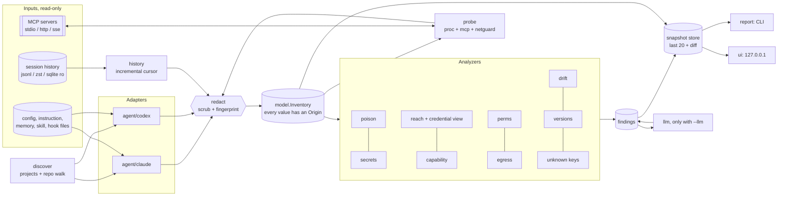

# jarx design

Status: draft v1. Last updated 2026-11-21. Goes with [prd.md](prd.md).

Go is decided. This doc covers everything else: how the code is split up, how
data moves through a scan, how the PRD's promises are enforced, and what gets
built first.

## Decisions from research

These came out of research and change or sharpen the PRD.

### Codex sqlite: open the original read-only

The PRD said `mode=ro&immutable=1`. The SQLite URI docs say that if a file
opened as immutable "changes anyhow, then SQLite might return incorrect query
results and/or SQLITE_CORRUPT errors", and immutable mode also skips the
`-wal` file. Codex writes these files while it runs, so immutable is wrong.

Copying the database and its WAL to temp was also rejected. It would put
history with secrets on disk, even for a moment, which breaks promise 3.

What jarx does:

- Opens the original with `mode=ro`, then sets `PRAGMA query_only = 1` and a
  short `busy_timeout` (2s).
- If the database is locked, or the open fails because the `-shm` file can't
  be used, jarx skips that file and adds an info finding ("Codex was busy, try
  again"). Partial data is never guessed at.
- jarx never writes, checkpoints or vacuums.

Source: https://www.sqlite.org/uri.html

### Probes never use a proxy

The dial-time IP block only works when jarx connects directly. Through a
proxy, the dialer only sees the proxy's address, and the proxy resolves the
target. So probe traffic ignores `HTTPS_PROXY` and friends. Behind a
corporate proxy, remote servers show as `unreachable`, and the "where your
agent talks to" panel says "proxy set, probes went direct".

Source: https://www.agwa.name/blog/post/preventing_server_side_request_forgery_in_golang

### Windows process trees: suspended start plus a job object

Calling `AssignProcessToJobObject` after `cmd.Start` is racy. The child can
spawn grandchildren before it's in the job (golang/go#79927). The fix for
that in `SysProcAttr` isn't in Go 1.25. jarx does this instead:

1. Create a job with `JOB_OBJECT_LIMIT_KILL_ON_JOB_CLOSE`. The handle is not
   inheritable.
2. Start the server with `CREATE_SUSPENDED`.
3. Assign it to the job.
4. Resume it with `NtResumeProcess`.
5. On timeout or when done, close the job, which kills the whole tree.

On unix, the same thing is `Setpgid` plus `kill(-pgid, SIGKILL)`.

This makes `golang.org/x/sys/windows` a direct dependency. It was already an
indirect one through go-keyring and modernc sqlite.

Sources: https://github.com/golang/go/issues/79927,
https://learn.microsoft.com/en-us/windows/win32/procthread/job-objects

### Hardened git for repo walks

A repo's own `.git/config` can point at commands (`core.fsmonitor`, diff
drivers). A clone doesn't carry config, but a repo that arrived as an archive
can. So jarx runs exactly:

```
git -c core.fsmonitor=false -c core.untrackedCache=false \
    ls-files -z --cached --others --exclude-standard
```

with `GIT_OPTIONAL_LOCKS=0` and a scrubbed env. It never touches
`safe.directory`. If git refuses or isn't installed, jarx uses its own walk.

### MCP client covers four protocol revisions

Revision 2026-07-28 removed protocol sessions and the GET stream from
Streamable HTTP. The client:

- offers every version it knows in `initialize` (2024-11-05 through
  2026-07-28)
- falls back to legacy SSE only when a POST gets `400`, `404` or `405`
  without a modern JSON-RPC error body (that's the spec's own rule)
- follows `nextCursor` on the list calls, up to 50 pages

Source: https://modelcontextprotocol.io/specification/2026-07-28/basic/transports/streamable-http

### Dashboard token goes into a cookie

`jarx ui` prints `http://127.0.0.1:<port>/?t=<token>`. The first request
trades the token for an `HttpOnly; SameSite=Strict` cookie and redirects with
303, so the token leaves the address bar and the browser history. Writes are
checked by Go 1.25's `http.CrossOriginProtection` (it uses `Sec-Fetch-Site`
and `Origin`). Every request also goes through a Host allowlist
(`127.0.0.1:<port>`, `localhost:<port>`) to stop DNS rebinding. A strict CSP
blocks inline script, and `frame-ancestors 'none'` stops framing.

Sources: https://www.calhoun.io/csrf-protection-via-headers-in-go-125,
https://developer.mozilla.org/en-US/docs/Web/Security/Attacks/CSRF

## Guarantees enforced by structure

The PRD's promises shouldn't depend on everyone remembering them. Each one has
a spot in the code that makes breaking it hard.

| Promise | How the code makes breaking it hard |
|---|---|
| Secrets never leak | Model text fields are `redact.Text`. Only the `redact` package can build one (unexported field). `report`, `ui`, `snapshot` and `llm` only take `redact.Text`, so there's no way to put a raw string on screen, on disk or on the wire. |
| Never calls a tool | The `mcp` package has constants only for `initialize`, `notifications/initialized`, `tools/list`, `prompts/list` and `resources/list`. A `go/ast` test fails if any other method string shows up in the package. |
| Only the listed network calls | `netguard` is the only package allowed to build an `http.Client`, a transport or a dialer. golangci `forbidigo` bans `http.Get`, `http.DefaultClient`, `net.Dial*` and `http.Transport{` everywhere else. |
| Never writes agent config | Adapters get a read-only `fsys` view. The only writer is `jarxdir`, which is rooted at `os.UserConfigDir()/jarx` with `os.Root`. |
| Tests and demos never touch the real machine | Adapters take an injected `platform.Env` (home, GOOS, env, managed dirs, PATH). `forbidigo` bans `os.UserHomeDir`, `os.Getenv` and friends outside `platform`. `--home` builds a `platform.Env` with everything rooted in the fake home and no managed dirs, registry, plists, real env or real PATH. |
| Only approved dependencies | golangci `depguard` lists the five approved modules plus stdlib. A new import fails lint until someone approves it. |

## Architecture



Three layers, matching the PRD:

1. **Adapters** know one agent each: its paths, formats, precedence, trust
   rules and quirks. Nothing outside an adapter knows an agent's file layout.
2. **The model** is agent-neutral, and every value in it carries an `Origin`
   (file, scope, line where possible, and whether it's in effect, with a
   reason if not).
3. **Analyzers** only read the model. Adding an agent means writing an
   adapter. The analyzers stay the same.

The shape follows osv-scalibr (extractors feed an inventory, detectors read
it) and boughs' `internal/agent/<name>` split. jarx adds the `redact` and
`netguard` choke points that neither of those has.

## Data flow for one `jarx scan`

1. **platform** works out the OS paths. **discover** merges the agents'
   project records with the repos in `jarxdir`, then walks each repo with
   hardened `git ls-files` or the fallback walk.
2. Each **adapter** reads its files through `fsys`, parses them (JSON, JSONC,
   TOML, frontmatter), applies its own precedence and trust rules, and sends
   every string through **redact** before it reaches the model. Keys it
   doesn't recognize go to `model.Unknown`.
3. **probe** asks the model which servers the agent would start. Up to 4 run
   at once. **proc** spawns stdio servers in a job or process group.
   **netguard** handles remote servers. **mcp** sends `initialize` and the
   list calls. Results go through redact and land on `model.Server` with a
   status.
4. **history** loads its cursor and reads only new bytes. It records
   permission modes, cwds and secret fingerprints. Codex sqlite is opened
   read-only in place.
5. Each **analyzer** reads the model and emits findings:
   `finding.Finding{ID, Severity, Origin, Evidence redact.Text}`.
6. With `--llm`, **llm** shows the preview, sends redacted artifacts,
   validates the JSON (one retry) and checks the quotes. Results are cached by
   hash.
7. **snapshot** writes the masked JSON, prunes to 20 and diffs against the
   previous one. **drift** sends changed tools back through **poison**.
8. **report** prints the result. **ui** serves the same snapshot.

## Package layout

| Package | Job | PRD section |
|---|---|---|
| `cmd/jarx` | main, wiring only | CLI |
| `internal/cli` | subcommands with stdlib `flag` | CLI |
| `internal/platform` | OS paths, injected env, managed dirs, registry and plist reads | Scope, cross-platform rule |
| `internal/fsys` | read-only file view, size caps, skip list | Walking a repo |
| `internal/jarxdir` | `os.Root` on the jarx config dir: config, cursor, cache, fingerprint key | What jarx writes to disk |
| `internal/redact` | `Text` type, scrubber, `REDACTED:<type>`, HMAC fingerprint | Promise 4, Secrets |
| `internal/model` | agent-neutral inventory, `Origin`, `Unknown` | Architecture |
| `internal/finding` | Finding, severity, rule registry with IDs | Detection rules |
| `internal/discover` | project records, hardened git walk, stale detection | Project discovery |
| `internal/agent` | adapter interface, shared parsers (jsonc, frontmatter, `@` imports) | Architecture |
| `internal/agent/claude` | Claude paths, precedence, trust, MCP approval, modes | Scope: Claude Code |
| `internal/agent/codex` | Codex paths, profiles, legacy `sandbox_mode` switch, requirements | Scope: Codex CLI |
| `internal/catalog` | embedded data: builtin tools, vendors, advisories, secret patterns, each with an "as of" stamp | Built-in tools catalog, Vendor badge, Advisory data |
| `internal/credmeta` | cred locations and safe metadata parsers (aws config, ssh header, gh hosts, `.env` keys) | Credentials |
| `internal/analyze/secrets` | prefix and entropy patterns, the sees state | Secrets |
| `internal/analyze/poison` | text rules over every text the agent reads | Detection rules |
| `internal/analyze/perms` | effective permissions with origin and in-effect reason | Effective permissions view |
| `internal/analyze/reach` | per-channel verdicts, observed modes, credential view | Reachability verdicts, Credential view |
| `internal/netguard` | the one HTTP client: dial-time IP block, no redirects, no proxy | Network calls |
| `internal/proc` | `proc_windows.go` job objects, `proc_unix.go` process groups, baseline env | How a stdio server is started |
| `internal/mcp` | list-only client: stdio, streamable HTTP, legacy SSE, paging | The MCP client |
| `internal/probe` | which servers, env expansion rules, concurrency, status | MCP probing, Server status |
| `internal/analyze/capability` | three-layer view per tool | Capability view |
| `internal/analyze/egress` | the "where your agent talks to" panel | Where your agent talks to |
| `internal/snapshot` | versioned schema, retention, diff | Snapshots and diff |
| `internal/analyze/drift` | hash diffs, rerun poison on changed tools | Snapshots, Drift |
| `internal/history` | cursor, jsonl, zstd and read-only sqlite readers (observed formats) | Session history |
| `internal/analyze/versions` | installs, PATH winner, advisory match, catalog age warning | Agent installs and versions |
| `internal/analyze/unknown` | the unknown settings report | Unknown settings report |
| `internal/report` | terminal output | CLI |
| `internal/ui` | server, middleware (host, token, CSRF, CSP), templates, embedded static files | Dashboard |
| `internal/keystore` | go-keyring for jarx's own entry, or an env var name | Optional LLM review |
| `internal/llm` | OpenAI-compatible client over netguard, preview, schema check and retry, quote check, cache | Optional LLM review |
| `internal/fakemcp` | a tiny MCP server (stdio and HTTP) with scripted tools, used by probe tests and the demo home | MCP probing, Demo home |
| `tools/vendorseed` | dev-only registry seeding where the namespace matches the vendor domain. Never linked into jarx. | Vendor badge |
| `testdata/<agent>/<version>/` | fake home trees per agent version | Fixtures per agent version |
| `testdata/demo/` | the demo home with planted problems | Demo home |
| `internal/analyze/<name>/testdata/<RULE-ID>/{poisoned,clean}/` | each rule's own fixtures | Testing and done criteria |

### Fixtures

- **Per rule:** every rule ID gets a `poisoned/` and a `clean/` dir, written
  first as the failing test (TDD). A table test walks all rule dirs, so a
  rule without both fixtures fails the build.
- **Per agent version:** fake home trees under `testdata/<agent>/<version>/`.
  When a format changes, a new version dir is added and the old ones keep
  passing.
- **History shapes:** Claude transcripts and Codex rollouts follow our
  format notes in the boughs repo (`docs/format-claude-code.md`,
  `docs/format-codex.md`), including replay: Claude replays inside one
  transcript, and Codex replays earlier items into a new rollout under
  `sessions/YYYY/MM/DD/`. Fields those notes don't cover (mode fields, `.zst`,
  sqlite) are built from observed structure, with a note in the fixture.
- **Demo home:** `testdata/demo/` is a full fake home with planted problems.
  Its risky MCP server is `internal/fakemcp`, so probing it runs our code,
  not a real package. A test runs `jarx scan --home testdata/demo` and checks
  for the expected findings, so the demo can't silently stop showing them.
- **Line endings:** `.gitattributes` sets `* text=auto eol=lf`, and marks
  `*.sqlite`, `*.zst` and images as `binary`, so fixture bytes (and hashes)
  are identical on Windows and Linux runners.

## Dependencies

Stdlib plus these, and depguard enforces the list:

- `github.com/BurntSushi/toml`
- `github.com/zalando/go-keyring`
- `github.com/klauspost/compress` (zstd)
- `modernc.org/sqlite`
- `golang.org/x/sys` (Windows job objects)

`go.mod` targets Go 1.25 for `http.CrossOriginProtection` and `os.Root`.

## CI

One workflow, `.github/workflows/ci.yml`, on push to main and on PRs. No
release workflow yet.

- **test:** matrix of ubuntu, macos and windows. Runs `go build ./...`,
  `go vet ./...` and `go test -race ./...` (with `CGO_ENABLED=1` for the race
  detector). The test step runs under bash on every runner, because
  PowerShell splits `-coverprofile=...` badly.
- **lint:** gofmt check, then golangci-lint v2 pinned by SHA. The config uses
  `default: all`, and every disabled linter has a written reason.
  golangci's gosec linter covers gosec, so there's no separate job.
  `forbidigo` and `depguard` hold the choke points.
- **offline:** on ubuntu, `unshare -n` runs
  `jarx scan --home testdata/demo --no-probe --no-history` and expects
  success. With no network namespace, any network call fails the job, which
  proves the zero-network mode.
- **security:** govulncheck on every run, CodeQL weekly and on PRs.
- **hygiene:** a `go mod tidy` diff check. Dependabot for gomod and actions,
  with every third-party action pinned by SHA.

There's no Makefile, since make is awkward on Windows. CONTRIBUTING lists the
same commands CI runs. Fuzzing is for later.

## Build order

Each step only uses what came before it and ends with something testable.
Choke points come first, so nothing ever gets written against a
looser version of them.

1. **Repo skeleton and CI.** `go.mod`, `.gitattributes` (`* text=auto
   eol=lf`, binary fixtures marked), `cmd/jarx` printing its version, the
   workflow, and the golangci config with forbidigo and depguard already on.
   The rules have to exist before the code they guard, or the first package
   written breaks them and nobody notices. `.gitattributes` has to come
   before the first fixture, or Windows checkouts get CRLF bytes and hashes
   differ from Linux CI.
2. **platform, fsys, jarxdir.** Everything reads paths and files through
   these, and tests inject fakes through `platform.Env`. If they came later,
   early code would call `os.UserHomeDir` directly and tests would touch the
   real machine.
3. **redact.** `model` uses `redact.Text`, so it has to exist first. The
   no-leak test suite starts here and grows with each step.
4. **model and finding.** These are the shape every adapter writes into and
   every analyzer reads from. Getting `Origin` right now saves rewriting
   every adapter later.
5. **netguard.** Nothing uses it yet, but it's a choke point. Building it
   before `mcp` and `llm` means neither ever has a moment where it makes its
   own client. Its tests (redirects, link-local, metadata, IPv6 forms that
   wrap IPv4) don't depend on anything else.
6. **agent/claude, discover, report, cli scan.** The first vertical slice:
   `jarx scan --no-probe --no-history` lists Claude's projects, settings,
   instruction files, MCP config, skills and hooks. Claude goes first because
   it has the most surface and the most precedence rules. `--home` and the
   first bits of `testdata/demo/` land here too, since this is the first
   step with something to show. The demo grows with every later step. The
   offline CI job starts doing real work here, against the demo home.
7. **agent/codex.** A second adapter is what proves the model really is
   agent-neutral. Done now, any Claude-shaped assumptions in the model get
   caught while they're still cheap to fix.
8. **catalog, credmeta, analyze/secrets, analyze/poison.** The static
   checks. They need the full inventory from both adapters and nothing else.
   After this step, jarx is already useful without probing.
9. **analyze/perms, then analyze/reach.** Reach depends on effective
   permissions and on the builtin tools catalog from step 8. Observed modes
   come in at step 13, so reach ships with configured verdicts first.
10. **snapshot and diff.** Needed before drift, and it gives every following
    step a way to see regressions between scans.
11. **fakemcp, proc, mcp, probe.** The riskiest part (it runs code and
    talks to the network), so it comes after every guard it relies on:
    redact for stderr, netguard for remote servers, the model for "would the
    agent start it". `fakemcp` comes first so every probe test has a server
    to talk to. The `go/ast` method test lands with `mcp`.
12. **analyze/capability, analyze/egress, analyze/drift.** All three need
    probe results or snapshots.
13. **history.** It's last among the core features because it reads
    undocumented formats. It feeds observed modes into reach, the sees state
    into the credential view, and project cwds into discover, all of which
    already exist and just get more data.
14. **analyze/versions and analyze/unknown.** Small, independent, and only
    useful once both adapters are solid.
15. **ui.** The dashboard shows a snapshot, so it waits until the snapshot
    has everything in it. The security middleware and its tests come before
    any page.
16. **keystore and llm.** Optional, off by default, and the only feature that
    sends content off the machine. It goes last, so it sits on top of a
    finished redact, netguard and canary test suite.
