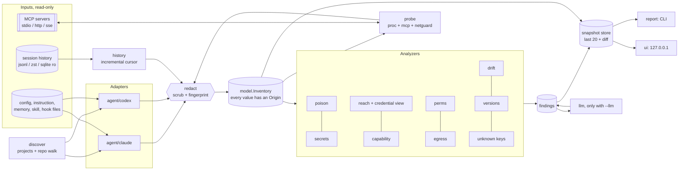

# jarx design

Status: draft v1. Last updated 2026-11-22. Goes with [prd.md](prd.md).

Go is decided. This doc covers everything else: how the code is split up, how
data moves through a scan, how the PRD's promises are enforced, and the phases
it gets built in. [progress.md](progress.md) tracks where we are.

## Decisions from research

These came out of research and change or sharpen the PRD.

### Codex sqlite: open the original read-only

The PRD said `mode=ro&immutable=1`. The SQLite URI docs say that if a file
opened as immutable "changes anyhow, then SQLite might return incorrect query
results and/or SQLITE_CORRUPT errors", and immutable mode also skips the
`-wal` file. Codex writes these files while it runs, so immutable is wrong.

Copying the database and its WAL to temp was also rejected. It would put
history with secrets on disk, even for a moment, which breaks promise 3.

What jarx does:

- Opens the original with `mode=ro`, then sets `PRAGMA query_only = 1` and a
  short `busy_timeout` (2s).
- If the database is locked, or the open fails because the `-shm` file can't
  be used, jarx skips that file and adds an info finding ("Codex was busy, try
  again"). Partial data is never guessed at.
- jarx never writes, checkpoints or vacuums.

Source: https://www.sqlite.org/uri.html

### Probes never use a proxy

The dial-time IP block only works when jarx connects directly. Through a
proxy, the dialer only sees the proxy's address, and the proxy resolves the
target. So probe traffic ignores `HTTPS_PROXY` and friends. Behind a
corporate proxy, remote servers show as `unreachable`, and the "where your
agent talks to" panel says "proxy set, probes went direct".

Source: https://www.agwa.name/blog/post/preventing_server_side_request_forgery_in_golang

### Windows process trees: suspended start plus a job object

Calling `AssignProcessToJobObject` after `cmd.Start` is racy. The child can
spawn grandchildren before it's in the job (golang/go#79927). The fix for
that in `SysProcAttr` isn't in Go 1.25. jarx does this instead:

1. Create a job with `JOB_OBJECT_LIMIT_KILL_ON_JOB_CLOSE`. The handle is not
   inheritable.
2. Start the server with `CREATE_SUSPENDED`.
3. Assign it to the job.
4. Resume it with `NtResumeProcess`.
5. On timeout or when done, close the job, which kills the whole tree.

On unix, the same thing is `Setpgid` plus `kill(-pgid, SIGKILL)`.

This makes `golang.org/x/sys/windows` a direct dependency. It was already an
indirect one through go-keyring and modernc sqlite.

Sources: https://github.com/golang/go/issues/79927,
https://learn.microsoft.com/en-us/windows/win32/procthread/job-objects

### Hardened git for repo walks

A repo's own `.git/config` can run commands or change what gets listed. A
clone doesn't carry config, but a repo that arrived as an archive can, and
`include.path` can pull in more. On git 2.39, a plain `ls-files` in a hostile
repo really does run `core.fsmonitor` and really does follow `core.worktree`
to list another dir. So jarx runs exactly:

```
git --no-pager --work-tree=<repo> \
    -c core.fsmonitor=false -c core.useBuiltinFSMonitor=false \
    -c core.untrackedCache=false -c core.hooksPath=<devnull> \
    -c core.excludesFile=<devnull> -c safe.bareRepository=explicit \
    ls-files -z --cached --others --exclude-standard
```

Command line `-c` beats everything in the repo's config, including what
`include.path` pulls in. The env is built from scratch: PATH from
`platform.Env`, `GIT_OPTIONAL_LOCKS=0`, `GIT_CONFIG_NOSYSTEM=1`,
`GIT_CONFIG_GLOBAL=<devnull>`, `GIT_TERMINAL_PROMPT=0`,
`GIT_CEILING_DIRECTORIES=<repo's parent>` (so a dir that isn't a repo can't
use a parent repo's config) and `LC_ALL=C`, plus `SystemRoot` on Windows.
Nothing else from jarx's own env comes along. Stderr is thrown away. There's
a 10s timeout and a 64 MiB output cap, and every path git prints has to be a
plain relative path inside the repo or the whole output is dropped.

`ls-files` without `-m`, `-s` or `--eol` never reads file content, so
filter, diff and textconv drivers don't run. The pager, hooks and untracked
cache flags are defense in depth: git 2.39 doesn't run them here, but other
versions or paths might.

What's left: `include.path` still makes git read the files it names. That's
a read, not a run, and nothing it pulls in can override the `-c` flags.

jarx never touches `safe.directory`. If git refuses, isn't on PATH, or the
dir isn't a repo, jarx uses its own walk through fsys. Under `--home` it
never runs git at all, so the demo and the tests never start a binary from a
fake PATH. Tests prove each real defense with throwaway repos whose config
writes a marker file if it ever runs.

### MCP client covers four protocol revisions

Revision 2026-07-28 removed protocol sessions and the GET stream from
Streamable HTTP. The client:

- offers every version it knows in `initialize` (2024-11-05 through
  2026-07-28)
- falls back to legacy SSE only when a POST gets `400`, `404` or `405`
  without a modern JSON-RPC error body (that's the spec's own rule)
- follows `nextCursor` on the list calls, up to 50 pages

Source: https://modelcontextprotocol.io/specification/2026-07-28/basic/transports/streamable-http

### Claude managed settings and trust

From the settings, settings-reference, managed-settings and permissions
pages (read 2026-11-22):

- Settings files are strict JSON. A comment or trailing comma is an error,
  so there's no JSONC parser.
- Managed sources rank remote > MDM (macOS plist or `HKLM`) > files >
  `HKCU`. Under the default `managedSourcesBehavior: "first-wins"` only the
  top source with a policy key counts, apart from a short list of keys read
  from every admin source. `"merge"` combines them by kind of key. `HKCU`
  counts only when no admin source is present. jarx records every source it
  sees and marks the ones that lose as not in effect.
- The files are `managed-settings.json`, then `managed-settings.d/*.json` in
  alphabetical order (hidden and non-`.json` files skipped). Windows'
  legacy `C:\ProgramData\ClaudeCode\` isn't read by Claude, so not by jarx.
- Registry: the JSON in a `REG_SZ` or `REG_EXPAND_SZ` value named
  `Settings` under `SOFTWARE\Policies\ClaudeCode`, in `HKLM` and `HKCU`.
  `platform` reads it with `golang.org/x/sys/windows/registry` in a
  `_windows.go` file. Other OSes and `--home` get "not available".
- jarx doesn't read the macOS plist at all. Claude's docs give only the
  domain, and Apple's docs don't say where managed preferences live on disk,
  so the PRD lists it under Limits.
- Which file a key may come from is the Scope column of the settings index
  (Any file, User or managed, Managed, Global config and so on). That table
  ships as embedded data with an "as of" date and doubles as the known-keys
  list for the unknown settings report.
- Trust is the documented `projects["<path>"].hasTrustDialogAccepted` in
  `~/.claude.json`, keyed on the git repo root. Parent folder trust doesn't
  count, and home dir trust is never written. Anything but a bool is
  "unknown".
- `settings.local.json` lives at the repo root, except on Windows, outside a
  repo, or when ownership doesn't match. A file left in the start dir by
  older versions is read too. If it's tracked in git or `.claude` is a
  symlink, its allows wait for trust like project ones.

Sources: https://code.claude.com/docs/en/settings,
https://code.claude.com/docs/en/settings-reference,
https://code.claude.com/docs/en/managed-settings,
https://code.claude.com/docs/en/permissions

### What an @import can point at

A CLAUDE.md `@import` is a path someone else wrote, and Claude follows it up
to four hops, absolute or relative. So jarx treats every import target, and
every symlink on the way to one, as untrusted. Checks live in `fsys`, so no
reader can skip them:

- **Credential files.** `fsys` asks `credmeta.Location` about the path and
  about where its symlinks lead, and refuses content reads of either with
  `ErrCredential`. Stat still works, for existence checks. An instruction
  that pulls in a credential is listed as "credential file, not read" and
  raised as `JARX-CLAUDE-002`, because Claude would load the secret even
  though jarx won't.
- **Network paths.** UNC paths (`\\host\share`, `\\?\UNC\...`), the `\\.\`
  device namespace, and `/net` and `/Network` on unix are refused from the
  text alone. A symlink is resolved one component at a time and its target
  is checked as text before anything looks it up, so a link to a share
  can't make jarx contact it (on Windows, a lookup can send the share your
  NTLM hash). `\\wsl$` is allowed, as the docs say it isn't a network path.
- **Things that aren't files.** `ReadFile` and `Open` stat first and refuse
  anything that isn't a regular file, so a FIFO can't block a scan and a
  device can't be read forever.
- **Loops and fan-out.** Imports stop at Claude's four hops, a file is listed
  once per project however often it's imported, and one file can name at
  most 500 imports.
- **Escaping the fake home.** Absolute import paths go through `MapPath`,
  and `os.Root` keeps every read and link under `--home` inside it.
- **The terminal.** A file name or file text is printed by `report`, which
  escapes C0 and C1 controls, DEL and the Unicode bidi controls, so a hostile
  name can't recolor, move the cursor, fake a new line or flip the text.

Sources: https://code.claude.com/docs/en/memory#import-additional-files,
https://code.claude.com/docs/en/memory#share-rules-across-projects-with-symlinks

### Nothing a hook, skill or plugin declares runs

Hooks, skills and plugins all carry things Claude runs: hook commands,
`http` hooks that POST to a URL, `mcp_tool`, `prompt` and `agent` hooks,
the `` !`cmd` `` and ` ```! ` blocks a skill runs before Claude sees it,
plugin hook scripts, plugin dependency installs and marketplace fetches.
jarx reads all of it as text and never runs any of it:

- Process starts are lint-banned outside `discover` (hardened git), and the
  network is `netguard`'s alone, so the adapter has no way to run a command
  or send a request.
- Commands are shown as written. jarx resolves only `${CLAUDE_PROJECT_DIR}`
  and `${CLAUDE_PLUGIN_ROOT}`, and only to find a hook script so it can read
  it. Every other variable stays as written, so an env secret can't end up
  in the output.
- Hook scripts and plugin files are read through `fsys`, with every guard
  from "What an @import can point at".
- A canary test plants each hook type, a hook script, skill injection and a
  plugin hook, each of which would write a marker file or call a local test
  server if it ran. It scans and checks that neither happened.
- `installed_plugins.json` names its fields in the docs but not its shape,
  so jarx reads it as an observed format and calls a plugin's install state
  unknown when the file doesn't match.

Sources: https://code.claude.com/docs/en/hooks,
https://code.claude.com/docs/en/skills,
https://code.claude.com/docs/en/sub-agents,
https://code.claude.com/docs/en/plugins/loading,
https://code.claude.com/docs/en/plugins-reference

### Dashboard token goes into a cookie

`jarx ui` prints `http://127.0.0.1:<port>/?t=<token>`. The first request
trades the token for an `HttpOnly; SameSite=Strict` cookie and redirects with
303, so the token leaves the address bar and the browser history. Writes are
checked by Go 1.25's `http.CrossOriginProtection` (it uses `Sec-Fetch-Site`
and `Origin`). Every request also goes through a Host allowlist
(`127.0.0.1:<port>`, `localhost:<port>`) to stop DNS rebinding. A strict CSP
blocks inline script, and `frame-ancestors 'none'` stops framing.

Sources: https://www.calhoun.io/csrf-protection-via-headers-in-go-125,
https://developer.mozilla.org/en-US/docs/Web/Security/Attacks/CSRF

## Guarantees enforced by structure

The PRD's promises shouldn't depend on everyone remembering them. Each one has
a spot in the code that makes breaking it hard.

| Promise | How the code makes breaking it hard |
|---|---|
| Secrets never leak | Model text fields are `redact.Text`. Only the `redact` package can build one (unexported field). `report`, `ui`, `snapshot` and `llm` only take `redact.Text`, so there's no way to put a raw string on screen, on disk or on the wire. Anything that matches a secret pattern is always masked. Entropy only flags a match as a likely placeholder, it never decides whether to mask, because showing a real secret is far worse than hiding a fake one. A reflection test walks every type reachable from `model.Inventory` and fails on a raw string anywhere: fields (exported or not), named string types, pointers, slices, arrays, map keys and values, `[]byte`, `[]rune`, interfaces, funcs, chans, embedded and generic types, and structs from other packages that aren't allowlisted. The test has one fixture per hiding spot, so a gap in the walker fails too. `model.Path` keeps the raw path only for fsys reads, and prints and encodes as the masked path for every fmt verb and in JSON. |
| Nothing raw reaches the terminal or a log | Only `report` writes output. `forbidigo` bans `fmt.Print*`, `fmt.Fprint*`, `os.Stdout`, `os.Stderr`, `print`, `println`, `log` and `log/slog` everywhere else (`cmd/jarx` may use `os.Stdout` and `os.Stderr` only to hand them to `report`). `report` takes values only as `redact.Text`, and its format string has an unexported type, so a string variable won't compile as the format. `report.Error` scrubs error text, since a parser error can quote the line it failed on. The limit: a package handed an `io.Writer` could still call `Write` on it, but only `cmd/jarx` can reach the real stdout and stderr, so that needs a new parameter that review would catch. |
| Never calls a tool | The `mcp` package has constants only for `initialize`, `notifications/initialized`, `tools/list`, `prompts/list` and `resources/list`. A `go/ast` test fails if any other method string shows up in the package. |
| Only the listed network calls | `netguard` is the only package allowed to make a network connection. golangci `forbidigo` bans `http.Get`, `http.Client`, `http.Transport`, `http.DefaultClient`, `net.Dial*`, `net.Dialer`, `tls.Dial*`, `tls.Client`, DNS lookups (`net.Lookup*`, `net.Resolver`), `net/smtp` and `net/rpc` everywhere else. Inside netguard, every connection is checked in the dialer's `Control` hook, after DNS and right before connect, on the exact IP being connected, so DNS rebinding and reconnects can't get past it. A literal IP host is also checked before dialing, because Go rewrites `0.0.0.0`, `::` and an empty host into a dial to the local machine before `Control` sees it. The tests run with a fake DNS server and a test-only rule that refuses any non-loopback connection, so a broken guard fails its tests instead of reaching a real address. |
| Only discover runs a process | `forbidigo` bans `exec.Command`, `exec.CommandContext`, `exec.LookPath` (it reads the real PATH), `os.StartProcess` and `syscall.Exec`/`ForkExec` outside `discover`, which only runs hardened git. `proc` joins it in phase 4. git is found through `platform.Env`'s PATH, never under `--home`. |
| Never reads a credential value | `fsys` refuses content reads of any path `credmeta.Location` calls a credential, checked on the path and on where its symlinks lead, so following an `@import` or a symlinked rule can't open one. Stat still works for existence checks. The phase 5 metadata parsers get their input through an explicit `fsys` method, not by opening files themselves. |
| Never writes agent config | `fsys` has no write methods. The only writer is `jarxdir`, which is rooted at jarx's state dir (`os.UserConfigDir()/jarx`, or `<home>/.jarx-state` with `--home`) with `os.Root`. `forbidigo` bans `os.WriteFile`, `os.Create`, `os.Mkdir*`, `os.Remove*`, `os.Rename` and friends everywhere else (tests may write fixtures). |
| Tests and demos never touch the real machine | Adapters take an injected `platform.Env` (home, GOOS, env, PATH, state dir, system roots). `forbidigo` bans `os.UserHomeDir`, `os.Getenv` and friends outside `platform`, and bans `os.Open`, `os.ReadFile`, `os.Stat`, `os.OpenRoot`, `filepath.Walk*` and friends outside `fsys`, `jarxdir` and `platform`. Under `--home`, `fsys` confines every read to the fake home with `os.Root`, so a fixture that points at a real path, a `..` trick or a symlink can't reach the real machine. `--home` builds a `platform.Env` with no system roots, registry, plists, real env or real PATH. |
| Only approved dependencies | golangci `depguard` lists the five approved modules plus stdlib. A new import fails lint until someone approves it. |

## Architecture



Three layers, matching the PRD:

1. **Adapters** know one agent each: its paths, formats, precedence, trust
   rules and quirks. Nothing outside an adapter knows an agent's file layout.
2. **The model** is agent-neutral, and every value in it carries an `Origin`
   (file, scope, line where possible, and whether it's in effect, with a
   reason if not).
3. **Analyzers** only read the model. Adding an agent means writing an
   adapter. The analyzers stay the same.

The shape follows osv-scalibr (extractors feed an inventory, detectors read
it) and boughs' `internal/agent/<name>` split. jarx adds the `redact` and
`netguard` choke points that neither of those has.

## Data flow for one `jarx scan`

1. **platform** works out the OS paths. **discover** merges the agents'
   project records with the repos in `jarxdir`, then walks each repo with
   hardened `git ls-files` or the fallback walk.
2. Each **adapter** reads its files through `fsys`, parses them (JSON, JSONC,
   TOML, frontmatter), applies its own precedence and trust rules, and sends
   every string through **redact** before it reaches the model. Keys it
   doesn't recognize go to `model.Unknown`.
3. **probe** asks the model which servers the agent would start. Up to 4 run
   at once. **proc** spawns stdio servers in a job or process group.
   **netguard** handles remote servers. **mcp** sends `initialize` and the
   list calls. Results go through redact and land on `model.Server` with a
   status.
4. **history** loads its cursor and reads only new bytes. It records
   permission modes, cwds and secret fingerprints. Codex sqlite is opened
   read-only in place.
5. Each **analyzer** reads the model and emits findings:
   `finding.Finding{ID, Severity, Origin, Evidence redact.Text}`.
6. With `--llm`, **llm** shows the preview, sends redacted artifacts,
   validates the JSON (one retry) and checks the quotes. Results are cached by
   hash.
7. **snapshot** writes the masked JSON, prunes to 20 and diffs against the
   previous one. **drift** sends changed tools back through **poison**.
8. **report** prints the result. **ui** serves the same snapshot.

## Package layout

| Package | Job | PRD section |
|---|---|---|
| `cmd/jarx` | main, wiring only | CLI |
| `internal/cli` | subcommands with stdlib `flag` | CLI |
| `internal/platform` | OS facts only: home, GOOS, injected env, PATH, jarx's state dir, system roots (`/etc`, `/Library/Application Support`, `%ProgramData%`, `%ProgramFiles%`). Registry reads land here in phase 3 (macOS plists aren't read, see Limits in the PRD). Agent paths belong to the adapters, which join them onto these roots. | Scope, cross-platform rule |
| `internal/fsys` | the only file reader, with no write methods. Confined to the fake home under `--home`. A 10 MiB `ReadFile` cap, where every refused file is recorded so it becomes a "skipped, too large" finding and is never dropped silently. A skip list for bulk dirs (`node_modules`, `.git`, `vendor`, build output) that still keeps agent files inside them (`.claude/`, `.codex/`, `.agents/`, `CLAUDE.md`, `AGENTS.md`, `.mcp.json` and the like). Symlinks are listed but never descended into. Refuses network paths (and symlinks to them), anything that isn't a regular file, and content reads of credential locations (see "What an @import can point at"). | Walking a repo |
| `internal/jarxdir` | the only file writer: `os.Root` on jarx's state dir, atomic writes, for config, cursor, cache and fingerprint key. Also `config.json` (versioned, with the saved repos), which it reads without creating the state dir | What jarx writes to disk |
| `internal/redact` | `Text` type, scrubber that always masks pattern matches (with a likely placeholder flag for low entropy), `Secret` for values known to be secret, masks like `REDACTED:<type>:<12 hex fingerprint>`, HMAC fingerprint with a per-install key created lazily in the state dir. The secret patterns themselves arrive with `catalog` in phase 3. | Promise 4, Secrets |
| `internal/model` | agent-neutral inventory, `Origin`, `Path`, `Setting[T]` (one layer per scope, highest first, with each layer marked in effect or not and why; adapters decide, the model only holds the result), `Project`, `Unknown`. Grows per phase. | Architecture |
| `internal/finding` | Finding, severity, rules as plain values with IDs like `JARX-MCP-001`, a `Registry` built by `scan` from every analyzer's rules (no global registry), worst-first sort, and `JARX-SCAN-001` for files fsys skipped as too large | Detection rules |
| `internal/discover` | merges every adapter's project records with extra paths, sets each project's status (ok, stale, outside fake home, not absolute, can't check), reports fsys skips as findings, and walks each repo with hardened git or the fallback walk | Project discovery |
| `internal/agent` | the adapter interface (`Agent`, `Projects`), the optional `SettingsReader`, `InstructionReader` and `ExtensionReader` that discover calls, and the shared `Context` (env, fsys, scrubber). Shared parsers (frontmatter keys and raw blocks, tool lists, `@` imports) land here in phase 3. Claude settings are strict JSON, so there is no jsonc parser. | Architecture |
| `internal/agent/claude` | Claude paths, precedence, trust, MCP approval, modes | Scope: Claude Code |
| `internal/agent/codex` | Codex paths, profiles, legacy `sandbox_mode` switch, requirements | Scope: Codex CLI |
| `internal/catalog` | embedded data: builtin tools, vendors, advisories, secret patterns, each with an "as of" stamp | Built-in tools catalog, Vendor badge, Advisory data |
| `internal/credmeta` | cred locations and safe metadata parsers (aws config, ssh header, gh hosts, `.env` keys). `Location` lands in phase 3 because `fsys` needs it to refuse credential reads; the parsers come in phase 5. It never imports `fsys`. | Credentials |
| `internal/analyze/secrets` | prefix and entropy patterns, the sees state | Secrets |
| `internal/analyze/poison` | text rules over every text the agent reads | Detection rules |
| `internal/analyze/perms` | effective permissions with origin and in-effect reason | Effective permissions view |
| `internal/analyze/reach` | per-channel verdicts, observed modes, credential view | Reachability verdicts, Credential view |
| `internal/netguard` | the one HTTP client. Blocks link-local, cloud metadata (including AWS over IPv6 and Alibaba's `100.100.100.200`), unspecified addresses and every IPv6 form that wraps a blocked IPv4 (mapped, compatible, NAT64, 6to4; Teredo and local-use NAT64 outright). Separate dial paths by scheme: https goes through the block then TLS, plain http also has to reach loopback. No proxy, no redirects, a 10 MiB body cap, 64 KiB headers, a 20s ceiling, no compression. | Network calls |
| `internal/proc` | `proc_windows.go` job objects, `proc_unix.go` process groups, baseline env | How a stdio server is started |
| `internal/mcp` | list-only client: stdio, streamable HTTP, legacy SSE, paging | The MCP client |
| `internal/probe` | which servers, env expansion rules, concurrency, status | MCP probing, Server status |
| `internal/analyze/capability` | three-layer view per tool | Capability view |
| `internal/analyze/egress` | the "where your agent talks to" panel | Where your agent talks to |
| `internal/snapshot` | versioned schema, retention, diff | Snapshots and diff |
| `internal/analyze/drift` | hash diffs, rerun poison on changed tools | Snapshots, Drift |
| `internal/history` | cursor, jsonl, zstd and read-only sqlite readers (observed formats) | Session history |
| `internal/analyze/versions` | installs, PATH winner, advisory match, catalog age warning | Agent installs and versions |
| `internal/analyze/unknown` | the unknown settings report | Unknown settings report |
| `internal/report` | the only output writer: `Out` and `Err` streams that take a literal format and `redact.Text` values, and an `Error` that scrubs error text. Grows into the terminal report in phase 2. | CLI |
| `internal/ui` | server, middleware (host, token, CSRF, CSP), templates, embedded static files | Dashboard |
| `internal/keystore` | go-keyring for jarx's own entry, or an env var name | Optional LLM review |
| `internal/llm` | OpenAI-compatible client over netguard, preview, schema check and retry, quote check, cache | Optional LLM review |
| `internal/fakemcp` | a tiny MCP server (stdio and HTTP) with scripted tools, used by probe tests and the demo home | MCP probing, Demo home |
| `tools/vendorseed` | dev-only registry seeding where the namespace matches the vendor domain. Never linked into jarx. | Vendor badge |
| `testdata/<agent>/<version>/` | fake home trees per agent version | Fixtures per agent version |
| `testdata/demo/` | the demo home with planted problems | Demo home |
| `internal/analyze/<name>/testdata/<RULE-ID>/{poisoned,clean}/` | each rule's own fixtures | Testing and done criteria |

### Fixtures

- **Per rule:** every rule ID gets a `poisoned/` and a `clean/` dir, written
  first as the failing test (TDD). A table test walks all rule dirs, so a
  rule without both fixtures fails the build.
- **Per agent version:** fake home trees under `testdata/<agent>/<version>/`.
  When a format changes, a new version dir is added and the old ones keep
  passing.
- **History shapes:** Claude transcripts and Codex rollouts follow our
  format notes in the boughs repo (`docs/format-claude-code.md`,
  `docs/format-codex.md`), including replay: Claude replays inside one
  transcript, and Codex replays earlier items into a new rollout under
  `sessions/YYYY/MM/DD/`. Fields those notes don't cover (mode fields, `.zst`,
  sqlite) are built from observed structure, with a note in the fixture.
- **Demo home:** `testdata/demo/` is a full fake home with planted problems.
  Its risky MCP server is `internal/fakemcp`, so probing it runs our code,
  not a real package. A test runs `jarx scan --home testdata/demo` and checks
  for the expected findings, so the demo can't silently stop showing them.
- **Line endings:** `.gitattributes` sets `* text=auto eol=lf`, and marks
  `*.sqlite`, `*.zst` and images as `binary`, so fixture bytes (and hashes)
  are identical on Windows and Linux runners.

## Dependencies

Stdlib plus these, and depguard enforces the list:

- `github.com/BurntSushi/toml`
- `github.com/zalando/go-keyring`
- `github.com/klauspost/compress` (zstd)
- `modernc.org/sqlite`
- `golang.org/x/sys` (Windows job objects)

`go.mod` targets the latest stable Go (1.27.4 right now). jarx needs at least
1.25 for `http.CrossOriginProtection` and `os.Root`.

## CI

One workflow, `.github/workflows/ci.yml`. The repo is private, so it's set up
to keep Actions minutes low:

- **Every push, any branch:** the linux jobs (test, lint, vuln).
- **Pull requests:** only the windows and macos test jobs. The PR branch
  already got linux from its push, so linux doesn't run twice.
- Newer runs on the same branch cancel older ones. Every job has a timeout,
  the token is read-only, and checkout doesn't keep credentials.

Jobs:

- **test:** `go build ./...`, `go vet ./...` and `go test -race ./...` (with
  `CGO_ENABLED=1` for the race detector). Every step runs under bash on every
  runner, because PowerShell splits `-coverprofile=...` badly.
- **lint:** a gofmt check, then `go mod tidy -diff`, then golangci-lint
  v2.15.0. The config (`.golangci.yml`) uses `default: all`, and every
  disabled linter has a written reason. golangci's gosec linter covers gosec,
  so there's no separate job. `forbidigo` and `depguard` hold the choke points.
  `uniq-by-line` is off, so another linter on the same line can't hide a
  forbidigo ban message.
- **vuln:** govulncheck, run with `go run` at a pinned version.
- **offline:** on ubuntu, `jarx scan --home testdata/demo` runs inside a
  network namespace with no network at all, under `strace -f`. It has to
  succeed, print the demo's projects and leave no state behind, and the job
  fails on **any** network syscall (`socket`, `connect`, `sendto` and the
  rest), even one that failed. The namespace alone wouldn't be enough: a
  connection attempt fails instantly there, and if jarx quietly handled that
  error the scan would still pass. Ubuntu blocks unprivileged user
  namespaces, so `sudo unshare --net` makes the namespace and `sudo -u` drops
  back to the runner user, so jarx never runs as root. A control step first
  proves both layers work: `curl` has to fail inside the namespace, and
  `strace` has to see `curl`'s connection attempt, so a blind audit can't
  make the job pass. `--no-probe` and `--no-history` join the command when
  they exist (phases 4 and 6).

The Go version comes from `go.mod`, so CI and local builds match. Every action
is pinned by SHA with the version in a comment.

Not set up for now, since the repo is private: CodeQL, Dependabot and any
release workflow. Bumping action SHAs is manual until then.

There's no Makefile, since make is awkward on Windows. CONTRIBUTING lists the
same commands CI runs. Fuzzing is for later.

## Build phases

jarx gets built in eight phases. Each phase only uses what came before it and
ends with something you can run or see. Choke points come first, so nothing
ever gets written against a looser version of them.

Each phase is one PR, opened as a draft early so CI runs on all three OSes
on every push. Each item in [progress.md](progress.md) is one commit in that
PR. That file is the checklist, and it gets ticked in the same commit as the
work.

`jarx scan` grows a little in every phase. Each phase adds to `testdata/demo/`
too, so the thing you run at the end of a phase shows that phase's work.

### Phase 1: Foundation

Repo skeleton, CI, lint guards, the CLI skeleton (`scan`, `--version`),
`platform`, `fsys` and `jarxdir`, and the first bits of `testdata/demo/`.

- The golangci config with `forbidigo` and `depguard` comes first. The rules
  have to exist before the code they guard, or the first package written
  breaks them and nobody notices.
- `.gitattributes` has to come before the first fixture, or Windows checkouts
  get CRLF bytes and hashes differ from Linux CI.
- Everything reads paths and files through `platform`, `fsys` and `jarxdir`,
  and tests inject fakes through `platform.Env`. If they came later, early code
  would call `os.UserHomeDir` directly and tests would touch the real machine.
- `--home` lands here, with `platform`, since that's where the fake home gets
  built.

**Run it:** `jarx scan --home testdata/demo` prints what jarx resolved: the
home dir, the OS, where the env comes from, the system roots (skipped with
`--home`) and jarx's own state dir, each with whether it exists. Without
`--home` it does the same for the real machine, existence only.

### Phase 2: Core engine

`redact`, `model` and `finding`, `netguard`, `discover`, `report`, the
project-record readers in both adapters, and `jarx setup repo add|rm`.

- `model` uses `redact.Text`, so `redact` comes first. The no-leak test suite
  starts here and grows with each phase.
- `model` and `finding` are the shape every adapter writes into and every
  analyzer reads from. Getting `Origin` right now saves rewriting every
  adapter later.
- `netguard` has no users yet, but it's a choke point. Building it before
  `mcp` and `llm` means neither ever has a moment where it makes its own
  client. Its tests (redirects, link-local, metadata, IPv6 forms that wrap
  IPv4) don't depend on anything else.
- `discover` needs project records, and only adapters know where those live
  (`~/.claude.json`, Codex `[projects]`), so the record readers land here as
  the first piece of each adapter.
- The offline CI job turns on.

**Run it:** `jarx scan --home testdata/demo` lists every project both agents
know about, marks stale ones, and shows file counts from the hardened git
walk. `jarx setup repo add <path>` adds a project and the next scan lists it.

### Phase 3: Instruction files and settings

The Claude adapter, then the Codex adapter: settings with precedence and
trust, instruction files (parent folders, subfolders, `@` imports), memory,
output styles, skills, commands and hooks. Then `catalog` (secret patterns),
`analyze/secrets`, `analyze/poison`, `analyze/perms`, `analyze/unknown`, and
`snapshot` with diff.

- Claude goes first because it has the most surface and the most precedence
  rules. Codex right after is what proves the model really is agent-neutral,
  while Claude-shaped assumptions are still cheap to fix.
- `perms` lands here because it's built from settings, and both the MCP
  capability view (phase 4) and the credential verdicts (phase 5) need it.
- `snapshot` lands here so every later phase can see regressions between
  scans, and because drift (phase 4) needs it.

**Run it:** `jarx scan --home testdata/demo` shows each project's instruction
files, skills, hooks and effective permissions, and flags the demo's planted
problems: hidden unicode, the HTML comment aimed at the agent, the skill with
injection text, `bypassPermissions` and `Bash(*)`. Change a demo file, scan
again, and the change shows up.

### Phase 4: MCP

MCP config in both adapters with the "would the agent start it" logic, then
`fakemcp`, `proc`, `mcp`, `probe`, the MCP config rules, `analyze/capability`
and `analyze/drift`.

- This is the riskiest part (it runs code and talks to the network), so it
  comes after every guard it relies on: redact for stderr, netguard for remote
  servers, the model for "would the agent start it".
- `fakemcp` comes first so every probe test has a server to talk to. The
  `go/ast` method test lands with `mcp`.
- `--no-probe` lands here.

**Run it:** `jarx scan --home testdata/demo` probes the demo's fake poisoned
server, lists its tools with a status, and flags the poisoned descriptions,
the unpinned `npx` server and the token in the URL. `--no-probe` shows the
servers as "not started".

### Phase 5: Credentials and reach

`credmeta`, the built-in tools catalog, `analyze/reach` with the credential
view, `analyze/egress` and `analyze/versions`.

- `reach` needs effective permissions (phase 3), the built-in tools catalog,
  and MCP servers as a channel (phase 4). It ships with configured verdicts.
  Observed modes come in phase 6.
- `egress` needs MCP host status, so it comes after probing.
- `versions` is the "vulnerable agent version" exposure check, so it sits with
  the other exposure work.

**Run it:** `jarx scan --home testdata/demo` shows each credential location
per project with its state (can read, can use, not reachable), per-channel
verdicts and the why trail. It also shows where each agent talks to and flags
a vulnerable agent install in the demo.

### Phase 6: History

The history cursor and readers for Claude transcripts, Codex rollouts (zstd)
and Codex sqlite, then wiring the results into what already exists.

- It comes last among the core features because it reads undocumented
  formats. It feeds observed modes into reach, the "sees" state into the
  credential view, and session cwds into discover. Those already exist and
  just get more data.
- `--no-history` lands here.

**Run it:** the demo home gets fake transcripts and rollouts. `jarx scan
--home testdata/demo` shows things like "14 of 20 sessions in bypass" next to
a verdict, and a leaked secret masked with its file and line.

### Phase 7: Dashboard

Before this phase starts, we stop and talk about how the UI should look.

`ui` with its security middleware first (host check, token cookie, CSRF, CSP)
and its tests before any page. Then the pages, the snapshot picker, and the
write actions (repo add and remove, rescan).

- The dashboard shows a snapshot, so it waits until the snapshot has
  everything in it.

**Run it:** `jarx ui --home testdata/demo` and click through it.

### Phase 8: LLM review

`keystore`, `jarx setup llm`, the `llm` client (preview, schema check and
retry, quote check, cache), the canary test, `jarx scan --llm` and the
dashboard button.

- It's optional, off by default, and the only feature that sends content off
  the machine. It goes last, so it sits on top of a finished redact, netguard
  and canary test suite.

**Run it:** `jarx setup llm`, then `jarx scan --llm --home testdata/demo`
against your own endpoint.
